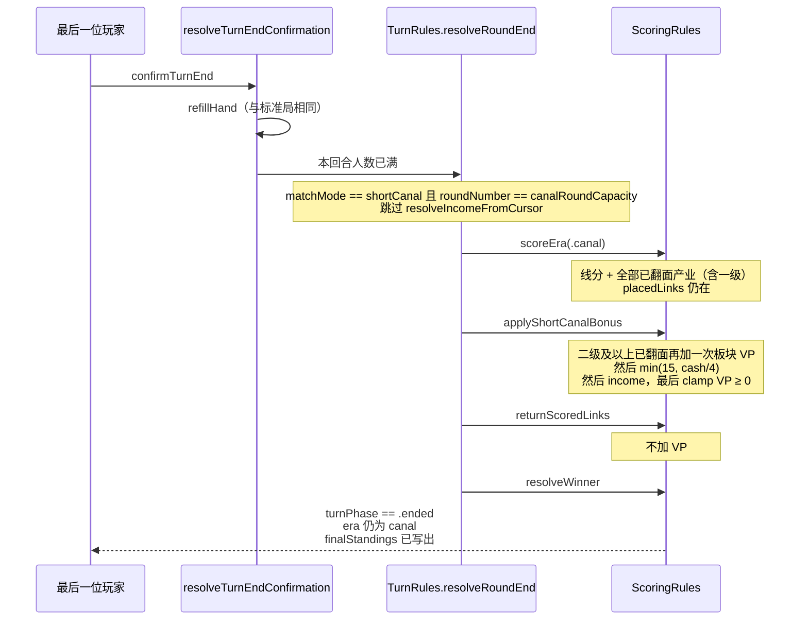
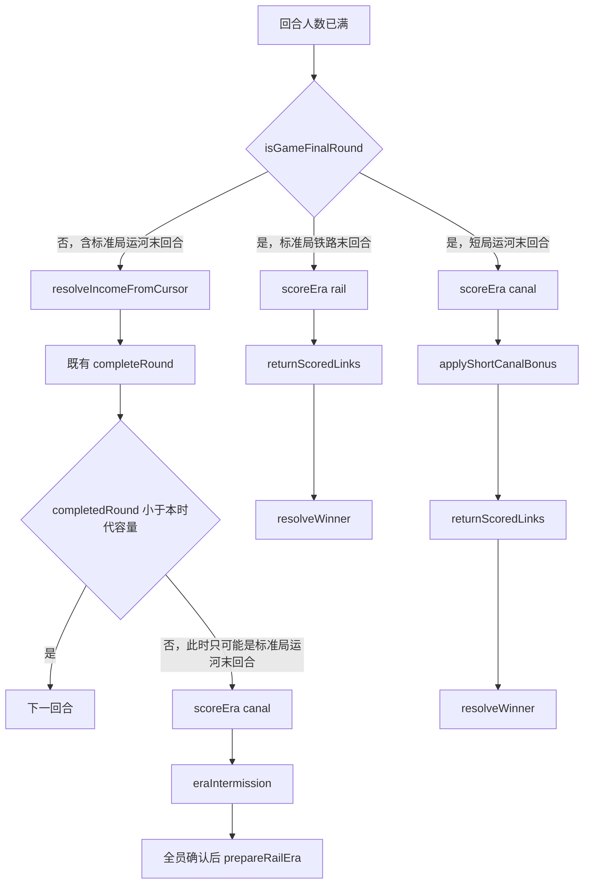

# 工业城市伯明翰：规则文档缺口（A–D）与运河新手短局实现规格

- 作者：待填写
- 日期：2026-10-15
- 状态：Draft
- 规则基线：仓库根目录 `RULES.md`（与 `ui-prototype/RULES.md` 有漂移，见背景）
- 数据基线：`ui-prototype/IndustrialCityBirmingham/GameData/v2018.11/`（`cards.json`、`map.json`、`merchants.json`、`income-track.json`、`industries.json`）。本文数字由这次对 JSON 的统计得到，不是沿用旧笔记。
- 代码基线：`ui-prototype/IndustrialCityBirmingham/GameCore/`
- 本文管辖：把规则书里已经由代码实现、但文档没写全的四条收成权威规则；设计并规定 `RULES.md` 第 11 节新手短局的唯一新玩法。不改已经正确的标准局玩法。

## 概述

标准局引擎已经按 Brass: Birmingham 规则书 2018.11 实现了四条 `RULES.md` 没写全的行为：运河时代 Birmingham 每人 2 个产业、产业牌与地点牌一样按 `playerCounts` 剔除、万能牌堆为空时侦察仍成功、连接片计分一次后在进入铁路时代前退回主人。前三条保持代码不动，只补文档和缺的回归断言。第四条里 `ScoringRules.scoreEra` 的两句中文注释是错的，会把后人带去“运河连线留到铁路时代再计一次分”；注释必须改。另外，铁路时代终局现在计分后把连接片留在地图上，要在不计第二次分的前提下撤线退回主人。

唯一的新玩法是第 11 节新手短局：只打完整运河时代，照常做运河计分，再按本文固定的顺序追加二次产业分、现金分和收入等级分，然后终局。标准模式的状态机、事件和计分函数在 `matchMode == .standard` 时保持现有行为；`GameState` 的 canonical bytes 也必须与今天一致，因为 `GameRulesEngineTests.seededCompleteGamesProduceReplayableDeterministicProofs` 把三份终局哈希钉死了，而且 `ResourceRules` 用 `GameState.canonicalHash()` 做资源事务摘要。标准局因此不把 `matchMode` 写进棋盘 JSON，协议仍是 2、快照 schema 仍是 4。短局由 `SnapshotStore.save` 写成协议 3、schema 5。只在读取规则里认 schema 5 不够：今天的 `save` 总会把信封盖成 `currentSchemaVersion`。

## 背景与现状

根目录 `RULES.md` 与 `ui-prototype/RULES.md` 不是同一份文件。`RulesCoverageTests.rulesURL()` 读的是后者（测试目录上两级的 `RULES.md`）。其他规格引用的是仓库根上的那份。两者目前只在第 9、10、14、15 节有差。原型副本已经有“伯明翰每人最多 2 个产业”和“连接片退回主人、铁路时代可再用”，根副本没有。两份都没有写产业牌按人数剔除、空万能堆侦察、计分与撤线之间的 `eraIntermission`，也都没有把第 11 节写成可实现的结算顺序。PR 必须按节改两份，禁止用其中一份覆盖另一份。

### A. 运河时代伯明翰例外

`RULES.md` 9.1 写“每位玩家在同一地点最多拥有 1 个产业”。规则书例外是：运河时代同一玩家可以在 Birmingham 拥有 2 个产业，其他地点仍是 1 个；不同玩家互不影响。铁路时代没有每地点个数上限（9.2 已写“只要有合法空位”）。

代码已经这样做。`BuildRules.validate`（`BuildRules.swift`）在时代检查之后：

```swift
let canalPerLocationLimit = intent.locationID == "birmingham" ? 2 : 1
if state.era == .canal,
   state.boardIndustryPlacements.filter({
       $0.ownerID == actorID && $0.locationID == intent.locationID
            && $0.slotIndex != intent.slotIndex
   }).count >= canalPerLocationLimit {
    throw BuildRuleError.canalLocationLimit
}
```

地点 id 是 `"birmingham"`，不是显示名。计数只看行动玩家自己的板块，并且排除正在覆盖的同一个 `slotIndex`，所以覆盖自己的那一格不算第二个产业。对手在同一地点的板块不占自己的名额。铁路时代整段 `if` 不执行。

`map.json` 里 Birmingham 有 4 个产业槽（0：棉纺/制造，1：制造，2：炼铁，3：制造）。这只说明第 3 个自己的产业有物理空位可被拒绝；上限来自规则，不来自槽数。

已有测试 `BuildAndNetworkRulesTests.wildBuildReturnsToPoolAndCanalOwnOneAndWrongEraFailClosed`：运河时代 Birmingham 已有自己的炼铁厂时，棉纺厂第二格 `validate` 成功；再放上第二块自己的产业后，第三格抛 `BuildRuleError.canalLocationLimit`。同函数后半段的铁路断言是农场啤酒厂 `wrongEra`，没有锁“铁路时代不套用每地点上限”。也没有锁“其他城市第二格拒绝”“覆盖同一 `slotIndex` 不计入”“对手板块不计入”。

### B. 产业牌也按人数移除

`RULES.md` 5.1 第 2 步写“移除人数标记高于当前人数的卡牌和贸易商板块”，但后面的清单只展开了地点牌颜色（2 人去掉蓝色和青绿色地点牌，3 人去掉青绿色地点牌）。实体产业牌同样带人数标记。

`SetupRules.makeGame` 对所有非万能牌过滤 `CardDefinition.playerCounts`，再用 `standardDeckCount` 强制张数：

| 人数 | `standardDeckCount` | 地点牌实例 | 产业牌实例 | 合计 |
| --- | ---: | ---: | ---: | ---: |
| 2 | 40 | 27 | 13 | 40 |
| 3 | 54 | 35 | 19 | 54 |
| 4 | 64 | 41 | 23 | 64 |

万能地点牌 `wild-location`、万能产业牌 `wild-industry` 各 `count == 4`，`playerCounts` 为 `[2, 3, 4]`，但 `kind` 被排除，不进摸牌堆，开局分别进入 `wildLocationPool` 与 `wildIndustryPool`。

2 人局被剔除的产业牌定义：`industry-cotton-manufacturer-3-plus`（6）、`industry-coal-mine-4`（1）、`industry-cotton-manufacturer-4`（2）、`industry-pottery-4`（1）。3 人局再放回第一张，仍剔除后三张（共 4 张实例）。4 人局产业牌定义全部进入。地点牌剔除与规则书颜色标记对应：2 人另剔 `location-leek`、`location-stoke-on-trent`、`location-stone`、`location-uttoxeter-3-plus` 以及 4 人卡 `location-belper`、`location-derby`、`location-uttoxeter-4`；3 人只剔这三张 4 人地点牌。这些 id 是数据事实，文档写“产业牌同样按 `playerCounts` 剔除”即可，不必把颜色名再发明进产业牌。

`map.json` 有 27 个地点，每个 `playerCounts` 都是 `[2, 3, 4]`。`BoardDefinition.Location.Kind` 是 `city`、`breweryFarm` 或 `merchant`。Warrington 与 Nottingham 是 `merchant`，`industrySlots` 为空，也没有 `location-warrington` 或 `location-nottingham`。被剔除的地点牌才对应可建造的城市，名单就是上面的 Leek、Stoke-on-Trent、Stone、Uttoxeter、Belper、Derby。这些牌被拿掉不等于从地图上删掉地点，这一点根 `RULES.md` 5.1 已经写了。贸易商格按人数变化，地点本身不按人数消失：2 人 5 格（Shrewsbury ×1、Gloucester ×2、Oxford ×2），3 人 7 格（加上 `warrington-1`、`warrington-2`，`playerCounts` 为 `[3, 4]`），4 人 9 格（再加 `nottingham-1`、`nottingham-2`，`playerCounts` 为 `[4]`）。贸易商板块实例数与格数相同（2/3/4 人为 5/7/9），`SetupRules` 用 `playerCount * 2 + 1` 校验。

回合容量是 `12 - playerCount`：2 人 10、3 人 9、4 人 8，写入 `canalRoundCapacity` 与 `railRoundCapacity`。运河第一回合每人 1 动（`TurnRules.actionsPerTurn`），其余每回合 2 动。每人行动数：2 人 19、3 人 17、4 人 15。开局每人 8 张手牌加 1 张扣置底牌。流通牌 = 标准牌堆减去底牌 = 行动总数：2 人 38、3 人 51、4 人 60。所以“行动弃 1 张 + 每人 1 张底牌”正好等于 40/54/64。若改成“只删地点牌、产业牌全留”，2 人会多出上面那 10 张产业实例（6+1+2+1），牌堆变成 50，不再等于 40。41 是 4 人地点牌总数，不是产业牌总数（全文件产业实例是 23），不要把 50 写成 54。时代回合数会因此和牌账分开。

引擎用回合容量结束时代（`TurnRules.completeRound` 比较 `roundNumber` 与容量），不是扫描“牌堆和手牌都空了”。两者在“每动恰好弃 1 张”时重合。侦察一动弃 3 张，会让牌堆更早耗尽，之后 `refillHand` 不再补牌，但回合仍走到容量。本规格不改这个结束条件。它只说明为什么产业牌必须跟着人数走：名义牌账是回合结构的一部分。

已有覆盖，不要再写一套牌数测试：

- `GameSetupTests.twoPlayerSetupUsesTheOfficialStartingShape`、`threePlayerSetupUsesTheOfficialStartingShape`、`fourPlayerSetupUsesTheOfficialStartingShape`，经私有 `verifySetup` 断言 40/54/64、每张标准牌的 `playerCounts` 含当前人数、万能牌各 4 张且不在摸牌堆。过滤条件是 `kind != wild`，产业牌包括在内。
- `TurnScoringRulesTests.railRedealUsesExactlyTheLegalCanalCardComposition` 再次断言铁路重发前的牌账是 40/54/64。

### C. 万能牌堆为空时仍可侦察

`RULES.md` 7.6 只写弃 3 张普通牌、取得 1 张万能地点牌和 1 张万能产业牌，以及手持任意万能牌不能侦察。

`SimpleActionRules.validateScout` 在手牌种类含 `.wildLocation` 或 `.wildIndustry` 时抛 `SimpleActionRuleError.wildHeld`。3 张牌必须存在、互不相同，且 `kind` 只能是 `.location` 或 `.industry`。然后：

```swift
wildLocationCard: state.wildLocationPool.last,
wildIndustryCard: state.wildIndustryPool.last
```

某一叠或两叠为空时，对应字段是 `nil`，`validate` 仍然成功。`GameRulesEngine.resolveScout` 先把这 3 张放进 `publicDiscard`，再只把非 `nil` 的那张从对应池 `removeLast` 后入手牌。两叠都空则手牌不增加万能牌。空堆不是 `wildPoolEmpty`；那个错误只在校验通过后、解析时池顶与 `ValidatedScoutTarget` 不一致时出现。

已有测试：

- `DevelopSellSimpleActionTests.scoutWithExhaustedWildPoolsStillExecutesAndGainsNothingFromEmptyPiles`：地点堆空、产业堆剩 1 张时成功且只拿到 `wild-industry`；两堆都空时断言手牌不含万能牌。两堆都空的断言是空集上的 `allSatisfy`，没有写明弃牌张数和手牌数量。
- `DevelopSellSimpleActionTests.scoutDiscardsThreeDistinctNormalCardsTakesBothWildsAndRejectsWhenWildHeld`：两张都拿到，随后手持万能牌被拒绝。

侦察落地后，`finishAction` 在本动是该回合最后一个行动时停在 `.awaitingTurnEndConfirmation`，补牌在 `confirmTurnEnd`。现有夹具把手牌换成恰好这 3 张，并且运河第 1 回合只有 1 动，所以两堆都空时解析结束的手牌恰好为空。这不是规则。手牌多于 3 张，或这一动是两动回合里的第一动，手牌都不会空，只是不会多出万能牌。测试注释里“手牌只有补牌”与这段代码不符。不要把“手牌变空”写进 `RULES.md`。

### D. 连接片的计分与退回

权威顺序是规则书加上 `RULES.md` 10.1 / 10.3，再补上文档没写清的“退回主人、铁路时代可再用”，以及本应用 6.1 把时代过渡放在确认时的扩展。

1. 时代结束时，每条自己的连接片按相邻地点上已翻面产业的 `level.linkPoints`，加上这些地点上贸易商板块的 `MerchantDefinition.linkPoints`，计一次分。未翻面产业不提供连接图标。`kidderminster-worcester` 的 `adjacentLocationIDs` 是 `kidderminster`、`worcester`、`kidderminster-worcester-farm`，不能假设只有 `endpoints` 里的两个端点。`scoreEra` 对 `placedLinks` 逐条计分；同一 `routeID` 上的两条记录会各计一次。那是引擎的逐条语义，测试夹具可以放两条，物理棋盘不会。本规格不改这条函数语义。
2. 计分之后连接片离开地图，双面连接片退回各自主人（`linksRemaining` 加回被撤下的条数），铁路时代可以再铺。运河连接片不会留在铁路时代再计一次分。
3. 已翻面产业按 `level.victoryPoints` 计分，未翻面不计。一级产业若在运河计分时已翻面，先在 `scoreEra` 里得分，然后才在 `prepareRailEra` 移出游戏。移出时煤、铁、啤酒按 `resourceCount` 退回 `publicSupply`。板块不回玩家垫板。
4. 铁路时代准备只在 `ScoringRules.prepareRailEra`，由 `GameRulesEngine.resolveEraConfirmation` 在全员确认 `eraIntermission` 之后调用。它才：移除一级产业并退资源、撤线退回、非空白贸易商（`acceptedIndustryIDs` 非空）的空啤酒位补 1 桶、手牌里的万能牌回各自池、手牌 + 扣置底牌 + 摸牌堆 + `publicDiscard` 用 `seed ^ 0x5241_494C_4552_4102` 洗成新摸牌堆、按 `playerOrder` 每人发 8 张、`privateBottomDiscard = nil`（不另发铁路时代底牌）。市场、现金、`incomePosition`、VP、`playerOrder` 不重置。`era` 改为 `.rail`，`roundNumber = 1`，`actionsRemaining = 2`。

代码的真实分界：

- `scoreEra` 不修改 `placedLinks`，`eraScored.removedRouteIDs` 固定是 `[]`。函数上的两句注释是错的：“运河连线保留到铁路时代，铁路末再次计分”以及“连线永久保留，时代结算不移除任何线路”。`prepareRailEra` 里的注释才是对的：计分后撤下，退回主人，铁路时代可再用。
- 因此运河连接片只在运河 `scoreEra` 计一次分。撤线发生在时代结算确认之后，不是计分函数里立刻移除。`turnPhase == .eraIntermission` 期间不能再行动（`GameStateAuthorityValidator.validTurnPhase` 要求行动数已经是 0），VP 不会被算两次。这符合 `RULES.md` 6.1：时代过渡在确认时发生。
- `TurnScoringRulesTests.canalPreparationPreservesMarketsRefillsMerchantsRedealsAndPreservesLongLivedState` 已经期望 `prepareRailEra` 之后 `placedLinks` 为空、铺过一条线的玩家 `linksRemaining` 回到 14。
- `TurnScoringRulesTests.eraScoringCountsEveryHyperedgeAdjacentFlippedIndustryAndKeepsAllLinks` 与 `eraScoringCountsAdjacentMerchantTileLinkIcons` 期望 `scoreEra` 之后线还在、`removedRouteIDs` 为空。断言与“计分函数本身不撤线”一致，必须保留。这两处“连线永久保留”的测试注释是错的，要改注释，不改断言。测试名被 `RulesCoverageTests` 按字符串引用，不要改名。
- 铁路终局走 `TurnRules.completeRound` 的 `else`：`scoreEra` 之后直接 `resolveWinner`。连接片留在地图上。没有下一次计分，所以 VP 碰巧没错，但终态不符合 10.1。本项要求终局也撤线退回，且不得因此再加 VP。
- `TurnScoringRulesTests.eraTransitionBatchReplaysAtomicallyAndRejectsEveryTamperedPosition` 钉死铁路回合结束事件数为 3：`roundEnded`、`eraScored`、`gameEnded`。撤线不能变成第四个 `GameTransitionEvent`。
- 全跳过的金哈希对局（`GameRulesEngineTests.runCompleteGame` 只提交 `pass`）不会铺线。终局撤线对这种对局是空操作。三份哈希不得因为本项改写：

  | 人数 | `finalHash` |
  | --- | --- |
  | 2 | `ae1e20cb0c0c354d23719f8cde0286168679f45b5e81b72553cc74749b2f23b9` |
  | 3 | `479b30f6929ff8c77b0a505bcfe8ff3105b8aaf2cf4a8c04cab70f71e577d7aa` |
  | 4 | `f0f69d8f7014aee0348661d20db7a214107fb149c884bce8f99afe7ee1ae27cf` |

收入轨与贷款不是本项的改动，只作为短局要读的既有事实：`income-track.json` 有 position 0…99。position 10 的 `income` 是 0（`SetupRules.startingIncomePosition`）。收入等级最高 30，对应 position 97、98、99。等级 -10…30 都有格。`SimpleActionRules.validateLoan` 已经把收入等级减 3，落到该等级 `position` 最大的一格，低于 -10 则拒绝。测试是 `DevelopSellSimpleActionTests.loanMovesDownThreeIncomeLevelsAndHonorsMinusTenFloor`。不要重写贷款。

### 第 11 节尚未实现

`RULES.md` 11 只说：只打运河时代并照常计分，然后每 £4 得 1 VP、最多 15 VP；按收入等级得等量 VP，负收入则扣等量 VP；所有二级及以上产业再结算一次产业 VP。并且“此变体不应影响标准模式的规则状态。”

代码里没有 `MatchMode`。`TurnRules.resolveRoundEnd` 只用 `era == .rail && roundNumber >= railRoundCapacity` 跳过收入。运河最后一回合，包括将来的短局，今天会走 `resolveIncomeFromCursor`。`completeRound` 在运河结束时一律 `enterEraIntermission`，确认后 `prepareRailEra`。没有短局追加分事件。

真实开局入口不是 DEBUG 的人数选择器。`RealSessionRootView.realLobby`（`LobbyView.swift` 前半，非 `#if DEBUG`）有准备和“开始比赛”，人数等于已加入并准备的座位数。`SessionViewStore.startGame` → `SessionCoordinator.startGame` → `SetupRules.makeGame(catalog:playerIDs:colors:)`。DEBUG `LobbyView` 的人数分段控件喂的是演示对局，不碰规则引擎。

## 目标与非目标

### 目标

- 把 A、B、C 写成权威规则。玩法保持现状。只补文档、修正会误导后人的注释、补上还没有的回归断言。
- 把 D 写成权威规则。有主人的运河线仍是 `scoreEra` 不撤、`prepareRailEra` 再撤。没有主人的孤儿线改为让过渡失败，不再被跳过；合法对局没有这种线。修正 `scoreEra` 的错误注释。铁路终局计分后撤线退回，VP 只加一次。
- 短局可以按本文直接实现：开局与运河时代相同，最后一回合不发收入，按固定顺序追加分数，不进入铁路时代，终局排名仍用现有 `resolveWinner`。
- `matchMode == .standard` 时，状态机、`GameTransitionEvent` 序列、计分结果与 `GameState` canonical bytes 与本规格落地前一致。

### 非目标

- 不修双铁路“先放两条再重算第一条的煤”。`NetworkRules.validate` 按线路顺序把连接片放进候选状态再算煤；`GameRulesEngine.resolveNetwork` 先把全部 `placedLinks` 追加进状态，再一次调用 `ResourceRules.consumeResources`。两处顺序不一致。本规格不改 `resolveNetwork`，也不改 `productionCount`（啤酒厂运河 1 桶、铁路 2 桶，其他产业读 `production.canalCount` / `railCount`）。
- 不裁定制造厂 4 级造价 £8 / £14，也不把 `GameData/v2018.11` 的 `manifest.json` 从 draft 改成 verified。
- 不改 `RULES.md` 6.1 的回合结束确认与整回合撤回。短局默认不把这套确认复用成“等待全员后再 `prepareRailEra`”。
- 不重写贷款、资源优先级、覆盖建造、出售奖励。
- 不改 DEBUG 演示大厅的皮肤和人数控件。不给标准局加 feature flag。

## 提议设计

### A. 运河时代伯明翰例外（文档 + 缺的断言）

权威规则，行为保持 `BuildRules.validate` 现状：

- 仅 `state.era == .canal` 时，每位玩家在同一地点的产业个数有上限。
- `locationID == "birmingham"` 的上限是 2，其他地点是 1。
- 只数 `ownerID == actorID` 的板块。对手的板块不占名额，所以不同玩家可以在同一地点各有自己的上限。
- 正在落入的 `intent.slotIndex` 不计入。覆盖自己已有的那一格不是“再增加一个产业”。
- 达到上限时抛已经存在的 `BuildRuleError.canalLocationLimit`，不新增错误码。
- 铁路时代不读取这个上限。空位、时代图标、覆盖建造的其他规则照旧。

PR 1 在 `wildBuildReturnsToPoolAndCanalOwnOneAndWrongEraFailClosed` 之外补断言，不要把 Birmingham 第 2 / 第 3 格再测一遍：

- 运河时代用 `nuneaton`，只按一个方向测。槽 0 是制造/啤酒，槽 1 是棉纺/煤矿。煤铁消耗都是 0 的运河板块只有 `coal-mine` 1 级和 `cotton-mill` 1 级，而且只能进槽 1。先占用槽 0（注入一块已在板上的自己的产业即可），再对槽 1 `validate` `coal-mine` 1 级或 `cotton-mill` 1 级，期望 `canalLocationLimit`。不要先占槽 1 再指望用零消耗板块去槽 0。`validate` 成功或失败还取决于牌、网络和槽位，不只取决于人数上限；夹具要把这三项配成合法，让拒绝理由只剩上限。
- 覆盖同一格：建造意图的 `slotIndex` 就是已占用的那一格。错误不得是 `canalLocationLimit`（会落到已有的 `emptySlotAvailable` 或 `illegalOverbuild`）。这锁住“排除正在覆盖的格子”。
- 对手已在该地点有产业时，自己的第一格仍然成功。
- 铁路时代，同一非伯明翰地点的第二格，以及 Birmingham 的第三格，`validate` 必须成功，而不是“失败但错误码不同”。用铁路合法且煤铁消耗为 0 的板块：`coal-mine` 2 级（`buildCost` 7，`railEra == true`）或 `manufacturer` 6 级（同样是 0 煤 0 铁，造价 £20）。开局现金是 £17，用制造厂 6 级时测试要把现金加到不少于 20。牌、网络和槽位仍然要合法。

### B. 产业牌按人数移除（只补文档）

权威规则：

- 摸牌堆 = `playerCounts` 包含当前人数、且 `kind` 不是 `.wildLocation` / `.wildIndustry` 的全部牌的实例。地点牌和产业牌同一条过滤。
- 张数必须是 2 人 40、3 人 54、4 人 64。`standardDeckCount` 对不上就抛 `SetupError.invalidCatalogCardCount`，这是数据门禁，不是可以放宽的提示。
- 禁止改成“只删地点牌”。否则牌账不再等于“每人行动数 × 人数 + 人数张底牌”，回合容量与牌堆会分家。
- 被移除的地点牌不删除地图地点。27 个地点在 2/3/4 人局都在。这句话对应被过滤的城市牌（Leek、Stoke-on-Trent、Stone、Uttoxeter、Belper、Derby），不是 Warrington / Nottingham。后两个是没有产业槽、也没有地点牌的 `merchant` 地点；变的只是贸易商格和板块。
- 万能牌各 4 张，始终在两个公共牌堆，不进摸牌堆，也不进铁路时代重组后的摸牌堆（`prepareRailEra` 已把它们从手牌拨回池中）。

PR 1 不新增牌堆测试。在两份 `RULES.md` 5.1 写明产业牌同样按人数标记移除，并指向已有的 `verifySetup`。可以在 `verifySetup` 加一句注释，说明断言覆盖产业牌，但不要复制一份只查产业牌的测试。

### C. 空万能堆侦察（权威规则 + 收紧一条断言）

权威规则，行为保持现状：

- 能侦察的前提不变：行动玩家、3 张互不相同的手里普通牌（地点牌或产业牌）、手中没有任何万能牌。
- 两叠都有牌：弃这 3 张到 `publicDiscard`，取每叠当前顶牌。顶牌就是数组的 `last`，不洗万能堆。
- 只有一叠有牌：侦察成功，只拿那一叠的顶牌，另一字段为 `nil`。
- 两叠都空：侦察成功，3 张普通牌仍弃掉，手牌不增加万能牌。
- 空堆不放松“手持万能牌则拒绝”。拿到一张万能牌之后，同一手牌里仍有它时不能再侦察。

PR 1 只收紧 `scoutWithExhaustedWildPoolsStillExecutesAndGainsNothingFromEmptyPiles` 的两堆都空分支：在这个夹具里 `hand.isEmpty`，`publicDiscard.count == 3`，两池仍空。`hand.isEmpty` 只因为夹具把手牌换成了这 3 张，而且运河第 1 回合只有 1 动，`finishAction` 在 `refillHand` 之前停住。不要把这条断言写成规则，也不要改成“任意局面侦察后手牌为空”。删掉“手牌只有补牌”这句注释。不要再写一个平行的侦察测试。单叠为空和手持万能牌的断言已经在上述两个测试里。

### D. 连接片计一次分，然后退回

把撤线从 `prepareRailEra` 的内联循环抽成 `ScoringRules.returnScoredLinks(state:)`，运河准备和两个终局共用这一份，避免两套退回逻辑以后分叉。

```swift
static func returnScoredLinks(state: inout GameState) throws {
    var ownerIndexes: [Int] = []
    ownerIndexes.reserveCapacity(state.placedLinks.count)
    for link in state.placedLinks {
        guard let index = state.players.firstIndex(where: { $0.id == link.ownerID }) else {
            throw ScoringRuleError.missingDefinition
        }
        ownerIndexes.append(index)
    }
    for index in ownerIndexes {
        state.players[index].linksRemaining += 1
    }
    state.placedLinks.removeAll()
}
```

语义：

- 不读、不写 `victoryPoints`。`eraScored.removedRouteIDs` 继续固定为 `[]`。
- 两遍扫描：先解析每条线的主人下标，全部存在才增加 `linksRemaining`，然后 `removeAll()`。缺主人抛 `ScoringRuleError.missingDefinition`，且一份余量都还没改。不要把抛错写在增加余量的循环里面。
- 今天的 `prepareRailEra` 遇到没有主人的线会跳过，然后仍然清空 `placedLinks`。合法对局的线都有主人。抽函数之后，孤儿线会让这次时代过渡失败，而不再被悄悄丢掉。这是可以接受的，因为 `GameRulesEngine.prepareRailEra` 和 `resolveRoundEnd` 都在候选状态上执行，抛错就不写回。有主人的线，加余量再清空，与现在的运河准备相同。
- 不设上限夹断。合法对局里铺线时已经减过余量，`GameStateAuthorityValidator` 要求余量在 0…14；退回是把这个守恒加回来。调用方不得对同一批线调用两次。
- 不产生 `GameTransitionEvent`。不要把铁路终局的撤线写进 `removedRouteIDs`，否则有线的终局事件会变，而本规格要求标准铁路终局的事件序列仍是 3 个。

调用点：

| 路径 | `scoreEra` | 撤线 | 是否再计分 |
| --- | --- | --- | --- |
| 标准运河结束 | 计分，线还在 | 不在 `completeRound` 里撤 | 否 |
| `eraIntermission` 全员确认后的 `prepareRailEra` | 不再调用 | 在移除一级产业之后、补贸易商啤酒之前调用 `returnScoredLinks` | 否 |
| 标准铁路终局 `completeRound` | 计分 | 紧接着 `returnScoredLinks`，然后 `resolveWinner` | 否 |
| 短局终局 | 只调用一次运河 `scoreEra` | 追加分之后调用一次 `returnScoredLinks`，然后 `resolveWinner` | 否 |

`scoreEra` 只删掉那两句错误注释，改成与上表一致的短注释：本函数只加 VP；运河线留到确认后的 `prepareRailEra` 再退回；铁路线由终局调用方退回；两种线都只计一次分。函数体除注释外不变。

禁止：为了“修正注释”而让运河 `scoreEra` 撤线，或让铁路时代对仍留在地图上的运河线再跑一次 `scoreEra`。`eraIntermission` 期间线还在地图上，是为了确认面板和棋盘一致；暂停中不能行动，所以不会插入第二次计分。

PR 1 新测试，放在 `TurnScoringRulesTests`，用现有 `setup` / `verifiedCatalog`，不要用 `DemoFixture`：

- 铁路时代、`roundNumber == railRoundCapacity`。一名玩家 `linksRemaining` 先改为 13，然后像 `canalPreparationPreservesMarketsRefillsMerchantsRedealsAndPreservesLongLivedState` 那样直接 `append` 一条 `PlacedLink`。不要走 `resolveNetwork`：那条路径会再把余量减 1，退回后是 13 而不是 14。
- `resolveRoundEnd` 之后：VP 等于计分前 VP 加上这一次线分和产业分，不是两倍；`placedLinks` 为空；该玩家 `linksRemaining == 14`；事件恰好是 `roundEnded`、`eraScored`（`removedRouteIDs` 为空）、`gameEnded`。
- 运河最后一回合的既有测试仍进入 `eraIntermission`，且 `scoreEra` 直接调用后线还在。不要改 `eraScoringCountsEveryHyperedgeAdjacentFlippedIndustryAndKeepsAllLinks` 的断言。

### 短局

`MatchMode` 只有两个值：`standard`、`shortCanal`。缺省 `standard`。短局的开局、牌堆、贸易商、回合容量、运河第一回合 1 动、其余 2 动，与同人数同种子的标准局运河时代相同。差别只在最后一回合的收入和时代结束之后。

#### 最后一回合不发收入

`RULES.md` 6.3：“游戏最后一回合不结算收入。”标准局的游戏最后一回合是铁路时代最后一回合，所以运河最后一回合仍然发收入，包括负收入和强制出售。短局的游戏最后一回合就是运河最后一回合，所以这次收入整个跳过：正收入不加现金，负收入不扣现金，也不进入 `.forcedSale`。

不要用 `era == .rail` 单独表示“游戏最后一回合”。谓词是：

```swift
static func isGameFinalRound(_ state: GameState) -> Bool {
    switch state.matchMode {
    case .standard:
        return state.era == .rail && state.roundNumber >= state.railRoundCapacity
    case .shortCanal:
        return state.era == .canal && state.roundNumber >= state.canalRoundCapacity
    }
}
```

`resolveRoundEnd` 在重排顺位、清零 `spent`、把 `roundIncomeCursor` 置 0 之后，若 `isGameFinalRound` 为真，直接 `completeRound`；否则仍走 `resolveIncomeFromCursor`。标准运河最后一回合的谓词为假，收入路径一个字节都不改。

`TurnScoringRulesTests.finalSeatActionAtomicallyCarriesReplayableEraTransitionsAndRailSkipsIncome` 已经把全体玩家的 `incomePosition` 设为 15（`income == 3`）、现金设为 20。铁路分支已经断言现金不变。PR 2 只在运河分支加一条断言：确认之后每人现金是 23，相位是 `eraIntermission`，转换里没有 `shortCanalScored`。这是给标准局加锁，不是改期望。不要改铁路分支。

#### 追加分

正常运河计分仍只由 `scoreEra` 完成：连接片 + 全部已翻面产业，含一级。`applyShortCanalBonus` 不得重做这两者。

追加分的权威解释：

- 二次产业分只给已翻面且 `tile.level >= 2` 的板块，再加一次该等级的 `victoryPoints`。产业类型不限（出售型、煤矿、炼铁、啤酒厂都算）。“所有”指地图上每一块符合条件的已翻面板块。未翻面产业两次都是 0。已翻面一级只出现在 `scoreEra` 的那一次。
- 连接片不因为短局再计一次分。事件里可以回显 `scoreEra` 已经加上的 `linkPoints`，但 `applyShortCanalBonus` 不加它。
- 现金分是 `min(15, max(0, cash) / 4)`，整数除法，余数丢掉。这 15 是上限，不是另加的一包。`GameStateAuthorityValidator` 已要求 `cash >= 0`；负数只作为防御，按 0。
- 收入分读 `incomeTrack.entries` 里该 `incomePosition` 的 `income`，不是轨道下标。正数加等量 VP，负数扣等量 VP。找不到该 position 抛 `ScoringRuleError.missingDefinition`。
- 扣分发生在现金分和二次产业分都已加入之后。结果 `max(0, victoryPoints)`，与 6.3 的 VP 底一致。不改 `victoryPointDebt`，不改现金，不改 `incomePosition`。
- 加法用现有的溢出检查（`addingReportingOverflow`）。溢出抛 `GameRulesEngine.GameRulesInternalError.arithmeticOverflow`，与 `scoreEra` 相同。

结算顺序，在最后一位玩家确认回合结束、且 `turnsCompletedInRound` 已凑满人数之后，原子完成：

1. `refillHand`：与标准局相同，在 `resolveTurnEndConfirmation` 里、`resolveRoundEnd` 之前。短局不取消这次补牌。
2. 重排顺位并清零花费。不发收入。
3. `scoreEra(.canal)`：线分 + 全部已翻面产业分，含一级。线还在地图上。
4. `applyShortCanalBonus`：二次产业分，然后现金分，然后收入等级分，最后把 VP 夹到大于等于 0。
5. `returnScoredLinks`：不加 VP。
6. `resolveWinner`：比较顺序不变，先 VP，再 `incomePosition`（不是收入等级），再现金，仍相同则并列。`turnPhase = .ended`，`finalStandings` 写出。

不做 `enterEraIntermission`，不调用 `prepareRailEra`。因此不移除一级产业，不补贸易商啤酒，不洗牌，不发 8 张，不把 `era` 改成 `.rail`，不清除扣置底牌。`era` 保持 `.canal`。短局没有单独的终局相位枚举；终局就是已有的 `.ended`。

默认不插入时代间暂停。最后一位玩家的 `confirmTurnEnd` 事件里依次带上 `roundEnded`、`eraScored`、`shortCanalScored`、`gameEnded`。确认之后不能进入铁路时代。若以后要做结算面板，可以复用 `EraAward` 的展示结构，但那个面板的确认目标必须是终局，不得调用 `prepareRailEra`。本规格不实现那个面板。



标准局对照。`isGameFinalRound` 为真只有两条出路：标准局的铁路末回合，以及短局的运河末回合。标准局运河末回合的谓词是假，留在发收入的那一侧，不许画成终局分支。



`isGameFinalRound` 为假时仍然调用现在的 `resolveIncomeFromCursor`，收入发完后由它进入 `completeRound`。`completeRound` 在这条路上只有两个出口：`completedRound < capacity` 时进入下一回合；否则是运河容量回合，`scoreEra(.canal)` 然后 `enterEraIntermission`。铁路容量回合不会出现在假分支上，因为标准局的铁路末回合已经使谓词为真，短局在运河容量回合也使谓词为真。不要在假分支上再画一个“跳过收入”或“直接下一回合而不调用 `completeRound`”。上面的时序图只描述短局真分支，不要用它覆盖这张图。

数字例子（实现测试时按目录现算，不要把魔法数写死在与目录无关的地方；下面这些等级值来自当前 `industries.json`，用来固定公式）：

- 已翻面 `coal-mine` 1 级：`victoryPoints` 1。只在第 3 步出现。
- 已翻面 `cotton-mill` 2 级：`victoryPoints` 5，`linkPoints` 2。第 3 步和第 4 步各加 5。
- 未翻面 `manufacturer` 2 级：两步都是 0。
- 一条邻接这块棉纺厂、不邻接贸易商地点的线（`birmingham-coventry` 的 `adjacentLocationIDs` 只有 `birmingham` 和 `coventry`）线分是 2，只加一次。一级煤矿必须放在这条线邻接不到的地点（不要放在 Birmingham 或 Coventry）。它的 `linkPoints` 也是 2；若它落在线上，线分变成 4，总和变成 15，而 15 不是这个例子的正确答案。煤矿在线外时，四步之后的 VP 是 1 + 5 + 5 + 2 = 13，不是 15，也不是 18。
- 现金 £0、£3、£4、£59、£60、£61 的现金分是 0、0、1、14、15、15。
- `incomePosition` 21 或 22 的 `income` 是 6，加 6。`incomePosition` 7 的 `income` 是 -3，扣 3。VP 已经是 0 时保持 0；VP 是 10 且没有其他追加分时变成 7。
- 顺序锁：追加分前 VP 为 0，现金 £4，收入等级 -3，空板。先加现金再扣收入，最终 VP 是 0。若先扣再加现金，会得到 1。测试必须得到 0。
- 平手：两人最终 VP 相同、现金相同，`incomePosition` 分别是 11 和 12（两者 `income` 都是 1，所以收入分相同，不会自己打破平手）。`resolveWinner` 把 position 12 排在前面，而不是因为收入等级相同就并列，也不是退回座次。

短局结束后的状态：

- `era == .canal`，`turnPhase == .ended`，`finalStandings` 非空，`actionsRemaining == 0`。
- `placedLinks` 为空，对应 `linksRemaining` 已加回。
- 一级产业还在 `boardIndustryPlacements`。
- 没有 `railPrepared`。`privateBottomDiscard` 仍在（验证器允许运河时代保留底牌）。摸牌堆、弃牌、手牌、底牌、万能池的牌 id 多重集，与计分开始前相同。最后一位玩家在计分前的那次 `refillHand` 是正常过轮，不算“重发”。
- 市场、现金、收入轨位置不因追加分本身改变。现金分只读现金。

`GameStateAuthorityValidator` 增加只对短局生效的条款：`matchMode == .shortCanal` 时 `era` 必须是 `.canal`，且 `turnPhase` 不得是 `.eraIntermission`。标准局不读这条款。`.ended` 今天不要求 `era == .rail`，短局终局因此已经能过时代检查；不要为了短局去要求铁路时代。

## 接口与状态变更

### `MatchMode`

放在 `GameState.swift`，与 `Era` 并列：

```swift
nonisolated enum MatchMode: String, Codable, Equatable, Sendable {
    case standard
    case shortCanal
}
```

`GameState` 增加 `var matchMode: MatchMode = .standard`。成员初始化的调用点靠默认值继续编译，包括 `legacyCompatible`。

编码：手写 `encode(to:)`，对今天 `CodingKeys` 里的每个字段保持与合成实现相同的写法。`JSONEncoder` 对 `nil` 可选值写出 `null`，不要改成 `encodeIfPresent` 把键省掉。仅当 `matchMode != .standard` 时写出 `matchMode`。解码 `decodeIfPresent ?? .standard`。

这不是风格偏好。`GameState.canonicalHash()` 被终局金哈希和 `ResourceRules` 的 `stateDigest` 使用。标准局多出一个 `"matchMode":"standard"` 就会改摘要。验收是这三份哈希原样通过，禁止改 `expectedHashes`。短局因为写出了键，哈希自然不同，不必钉金哈希。

### `SetupRules.makeGame`

```swift
mutating func makeGame(
    catalog verifiedCatalog: VerifiedGameDataCatalog,
    playerIDs: [PlayerID],
    colors: [PlayerID: PlayerColor] = [:],
    mode: MatchMode = .standard
) throws -> SetupResult
```

默认值放在最后，现有调用点不用改。`.standard` 时事件序列与今天相同，不增加 case。

`.shortCanal` 时在 `.gameCreated` 之后插入一条新的 `SetupEvent.Payload`：

```swift
case matchModeSelected(MatchMode)
```

不要给 `.gameCreated` 加关联值。那个 case 的编码必须保持原样。重放时，这条事件只能出现在 `gameCreated` 之后、`turnStateInitialized` 之前，且值只能是 `.shortCanal`。显式选择 `.standard` 视为 `SetupReplayError.invalidReplay` 的现有相位/牌堆类错误里最接近的一项（用 `.unexpectedPhase`），避免“缺字段”和“显式 standard”两种编码。缺事件就是 `.standard`。短局其余设置事件与标准局相同。

### 短局事件

`GameCore.GameTransitionEvent` 增加：

```swift
struct ShortCanalPlayerScore: Codable, Equatable, Sendable {
    let playerID: PlayerID
    let linkPoints: Int
    let industryPoints: Int
    let secondIndustryPoints: Int
    let cashPoints: Int
    let incomePoints: Int
    let victoryPoints: Int
}

struct ShortCanalScoredDetails: Codable, Equatable, Sendable {
    let awards: [ShortCanalPlayerScore]
}

case shortCanalScored(ShortCanalScoredDetails)
```

字段含义：

| 字段 | 含义 | 是否在本事件里再次加入 VP |
| --- | --- | --- |
| `linkPoints` | 刚才 `eraScored` 里该玩家的线分，按 `playerOrder` 回显 | 否 |
| `industryPoints` | 刚才 `eraScored` 里该玩家的产业分，含已翻面一级 | 否 |
| `secondIndustryPoints` | 已翻面且等级 ≥ 2 的板块 VP 之和 | 是，本事件之前已经加入 |
| `cashPoints` | `min(15, max(0, cash) / 4)` | 是 |
| `incomePoints` | 收入等级本身，可以为负；不是夹断后的实际加减量 | 是，然后才夹断 |
| `victoryPoints` | 夹断之后的最终 VP | 已是结果 |

`awards` 的顺序与 `scoreEra` 一样，按 `state.playerOrder`。`incomePoints == -3` 且最终 VP 为 0 时，事件仍记录 -3，不记录成 0。这样回放看得到名义扣分和地板。

`MatchActionLog` 的转换 `switch` 有 `default`，但要加显式分支，把每位玩家的五项分数和最终 VP 写进行动日志。`SessionProtocol` 对转换的 `switch` 也有 `default`，短局分数不是私有信息，走 `default` 即可，不要做成只给某一座位看的投影。`SessionDiagnostics` 不必为这个转换加描述，除非编译器要求。

`MatchProjection` 在 PR 2 就带上 `matchMode`，否则 PR 3 的局头没有字段可读。它今天是合成 `Codable`，没有手写的 `init(from:)` / `encode(to:)`。属性默认值不会在缺键时生效；合成解码要求非可选键存在。`turnActionsTaken` 能缺省只因为它是 `Int?`。`ViewSnapshot` 用 `decodeIfPresent` 读 `match`，嵌套解码一旦抛错，整张快照就抛错，现有带投影的标准局快照会全部加载失败。

因此 `MatchProjection` 必须改成与 `GameState` 相同的手写契约，不能只加一个带默认值的存储属性：

- `init(from:)` 对 `matchMode` 使用 `decodeIfPresent ?? .standard`。
- `encode(to:)` 只在 `matchMode == .shortCanal` 时写出该键。
- 今天已经编码的键，包括值为 `nil` 的 `turnActionsTaken`，保持合成实现的写法。不要对它们改用 `encodeIfPresent`。`JSONEncoder` 对 `nil` 可选值写出 `null`。
- 不要把 `matchMode` 放进 `computePublicChecksum()` 的 `PublicMaterial`。标准局 `publicChecksum` 必须不变。这个校验和本来就不会发现模式写错，所以它不能代替上面的编解码契约。

PR 2 加一条往返测试：一份没有 `matchMode` 键的 `MatchProjection` JSON 能解码为 `.standard`，再编码后与原文相比不多出该键，其余键保持原样。

### 终局撤线没有新事件

`returnScoredLinks` 的结果体现在撤线之后的 `GameState` 里。回合结束重放是重新执行 `TurnRules.resolveRoundEnd`，不是按事件字段把线删掉，所以不需要在 `eraScored` 里填 `removedRouteIDs`。标准铁路终局的事件数保持 3。短局是 4 个，多出来的只有 `shortCanalScored`。

## 数据模型与旧档兼容

标准局的 `GameState` canonical bytes 仍然不含 `matchMode`。短局不能靠“旧解码器会看见未知键然后拒绝”来保证安全：`JSONDecoder` 忽略未知键。今天的 `GameState.init(from:)` 会把一份进行中的短局读成普通运河局，`era` 仍是 `.canal`，线上还在，运河容量回合会进入 `eraIntermission`，然后 `prepareRailEra`。裸的 `GameState` JSON 不是兼容边界。

拒绝发生在信封上，而且只包住短局。标准局的协议和 schema 都不升。

| 模式 | 会话 `protocolVersion` | 快照 `schemaVersion` | `GameState` 里的 `matchMode` 键 |
| --- | --- | --- | --- |
| `standard` | 2。新房间的 `makeNearbyHost` / `makeNearbyGuest` 仍传入 2 | 4。`currentSchemaVersion` 保持 4 | 不写 |
| `shortCanal` | 3。同一个协调器上那个被档案和信封抄走的字段改为 3，不另做一次只出现在某一封 hello 里的 3 | 5。由 `save` 盖上，不是把 `currentSchemaVersion` 改成 5 | 写出 `"shortCanal"` |

`SnapshotEnvelope.init(archive:)` 今天是唯一的生产构造器，它把 `schemaVersion` 设成 `currentSchemaVersion`（4）。`SnapshotStore.save` 只调用这个构造器。若 `save` 不改，短局会被写成 schema 4 再加一个 `"matchMode"` 键。那正是下面要拒绝的形状：新加载器拒绝它，`makeCoordinator` 里三次失败后 `handleInvalidRecoveryMaterial` 会删档；旧加载器却接受 schema 4，忽略未知键，把进行中的运河局下进铁路时代。读取规则不能代替盖章。

`save` 的盖章：

- 仍先 `SnapshotEnvelope(archive:)`。校验和只覆盖 `archive`，不覆盖 schema，所以随后改 `schemaVersion` 不用重算校验和。
- 主机档案同时满足 `protocolVersion == 3` 和 `gameState.matchMode == .shortCanal` 时，把 `schemaVersion` 改成 5。
- 客机档案没有 `GameState`。同时满足 `protocolVersion == 3` 和快照里 `match.matchMode == .shortCanal` 时盖 5。缺投影不盖 5。
- 其余情况保持 4，包括标准局，以及协议与模式对不上的档案。不要为了测试在 `init` 之后手改 schema 就算通过；验收必须走 `save`。

`Configuration.protocolVersion` 和协调器上的 `private let configuration` 今天都是不可变的。`private let transport` 与它对齐：座位、令牌和 `NearbyTransport` 都在这一个 actor 上。不能为了换一个新的 `let` 去新建 `SessionCoordinator`，否则原来的连接已经没了，`versionIncompatible` 没有接收者。档案和发出的信封只抄一个协议字段：行动提交里的 `SessionArchive.host`、`persistCommittedState`、`persistGuestState`，以及 `makeEnvelope`。把这个字段留在 2，只在某一封 hello 里写 3，后面对局仍按 2 存档，主机按 3 拒绝。因此这个被抄走的字段改成 `var`。`configuration` 若仍是 `let`，结构体里的 `var` 也赋不了值，所以协调器上的 `configuration` 也改成 `var`，或者另用一个 `private var sessionProtocolVersion`，三处档案和 `makeEnvelope` 全部改抄它。两套数字不能并存。

新构建的 `supportedSchemaVersions` 是 `[2, 4, 5]`。`currentSchemaVersion` 仍是 4。`RealMatchProjectionTests.actionableProjectionUsesSnapshotSchemaFour` 继续断言 `currentSchemaVersion == 4`。`snapshotSchemaSupportIsExplicitAndDoesNotClaimSchemaThree` 的期望改为 `Set([2, 4, 5])`，仍然不包含 3。旧构建的集合仍是 `[2, 4]`。

`decodeCommittedArchive` 在 `requiresCurrentSchema` 时现在要求 `schemaVersion == currentSchemaVersion`，否则抛 `incompleteAuthorityState`。主机打开房间时 `makeCoordinator` 传入 `requiresCurrentSchema: verifiedCatalog != nil`，这个错误被当成“留着文件、另开一局新协调器”，短局不会被读回来。schema 5 必须算作短局的当前 schema，使这次比较通过。schema 2 仍不是当前 schema，现有的“留档待迁移”行为不变。不要去改 `RecoveryCoordinator.recover` 里那个 `switch schemaVersion`：它不在生产恢复路径上，`sendRecovery` 会重新投影快照。

通过“当前 schema”之后再查模式：

- schema 5 且模式是 `.shortCanal`：恢复。
- schema 5 但模式不是短局：`schemaMismatch`，不是 `incompleteAuthorityState`。
- schema 2 或 4 且解码出 `.shortCanal`：`schemaMismatch`。不许剥掉键之后当成标准运河局。
- schema 2 或 4 且没有该键：`.standard`。

旧构建看到 schema 5 时，支持集合里没有它，`decodeCommittedArchive` 抛 `schemaMismatch` 并且不返回档案，因此到不了 `prepareRailEra`。

房间列表和恢复不能继续写死协议 2：

- `recoverableHostRoomsValidated` 在有 catalog 时现在把 `expectedProtocol` 设成 2，并传 `requiresCurrentSchema: true`。协议 3 的档案会在这里 `protocolMismatch`，进不了列表。先按协议 2 加载；只有 `protocolMismatch` 时再用协议 3 试一次，两次都带 `requiresCurrentSchema: true`。无 catalog 的夹具路径仍用协议 1。成功的短局把协议 3 放进 `RecoverableSessionReference`。这个字段手写 `decodeIfPresent ?? 2`，避免合成解码把缺键当成失败。
- `NearbyHostRecoveryRoute.makeStore` 今天写死 `protocolVersion: 2`。它改为使用引用里的协议。短局引用是 3，`makeCoordinator` 的 `load` 期望也就 3，能读回存档。
- `makeNearbyHost` 创建新的标准房间时仍传 2。已经连上的房间不更换协调器，也不更换 `transport`。
- `makeNearbyGuest` 今天也总是传 2，目录按 `(roomID, playerID)` 固定。客机恢复使用和房间列表相同的探测，但 `requiresCurrentSchema` 保持默认 `false`：先按协议 2 `load`；只有 `protocolMismatch` 时再按协议 3 加载。协议 3 成功，则这一个协调器的可变协议改为 3，再用这份档案恢复。`missing` 或两次都失败才留在协议 2 的空座位。不要在 `protocolMismatch` 之后仍返回一个协议 2 的协调器并绑在同一目录上，否则下一笔 `save` 会撞上短局的提交序号。

网上的门用同一对版本。主机和客机保存的是同一个数，`makeEnvelope`、`submit` 里的 `PlayerIntent`、`handleAsHost` / `handleAsGuest` 的入站检查，以及 `startGame` 和恢复路径上的 `makeHostEngine` 都读它。主机把这个字段改成 3 之后，信封和存档都是 3。旧客机仍是 2，在改大厅状态之前就被拒绝，和 `SessionCoordinatorTests.compatibilityMismatchIsRejectedBeforeLobbyMutation` 一样，拿不到 `GameState`。标准局房间继续用协议 2。

`SessionProtocol.Payload.versionIncompatible` 没有关联值，客机看不出主机要的是 2 还是 3。因此客机跟随自己的存储值翻转，而不是一律改成 3：存储是 2 就改成 3 并 hello 一次；已经是 3 就改成 2 并 hello 一次。这次 hello 使用改过之后的存储值。没有本地存档的后加入者第一次 hello 仍是协议 2；主机若已经是 3，会在大厅状态改变前拒绝。同一个处理函数接这次拒绝，不能只写给“已经在局里”的座位。同一次加入里，翻转后的 hello 若再收到 `versionIncompatible`，就停止并显示错误，不要在 2 和 3 之间来回。成功加入之后，主机若在大厅里又改了一次模式，可以再翻转一次。

主机必须先写入新协议，再发 `versionIncompatible`。`makeEnvelope` 抄的是存储值；`await send` 会挂起这个 actor，客机的 hello 可以在通知还没发完时就进来。若通知发出时存储仍是旧协议，`handleAsHost` 会用旧值拒绝已经翻转的 hello，客机这一次跟随就用完了。`handleAsGuest` 在 `case .versionIncompatible` 之前不检查信封协议是否等于自己的存储值（协议相等检查在后面的 `.lobbyState` 等分支上），所以信封带上新协议也能被处理。跟上来的 hello 再按已经写好的存储值检查，于是对得上。切回协议 2 用同一顺序：先把存储改成 2，再通知。

发通知之前不从 `tokens` 里删人，这样 `await send` 期间按新协议到来的 hello 还能被留下。旧构建收到 `versionIncompatible` 会把 `joinOutcome` 设为 `.rejected(.incompatiblePeer)` 然后停下，不会再 hello。断线只把座位放进 `peersNeedingRecovery`，不把它移出 `tokens`。`playerIDs` 就是 `tokens.keys`，`startGame` 又要求 `ready == Set(tokens.keys)`，然后把这些 id 发给 `makeGame`。若旧座位还在，短局会给他们发牌，而他们说不了协议 3。

因此通知期间的名册是：

1. 先写入新协议。把除主机以外、当前已入座的玩家标成需要重新 hello，并清掉他们的 `ready`。此时还不删 `tokens`。
2. 再发 `versionIncompatible`。发送返回之前，按已经存好的协议 hello 的玩家取消这个标记，留在座位上。
3. 全部发送返回之后，仍带着标记的人从 `tokens` 和 `ready` 去掉。什么都不发的人在这里被去掉。协议不对的 hello 同样去掉。
4. 然后 `broadcastLobbyState()`。广播出去的是这份缩小后的名册，被去掉的人不在 `ready` 里。
5. `startGame` 只给剩下的 `tokens` 发牌。旧构建因此不会坐进短局。
6. `startPhase == .notStarted` 时，稍后按已经存好的协议再 hello、而 `tokens` 里还没有这个人，仍然可以重新入座。被扫掉的新客机可以这样回来。旧客机不会说这个协议，所以回不来。

切回协议 2 用同一套名册规则。

`handleAsHost` 今天把协议不符和规则集不符放在同一个 `guard` 里，都回 `versionIncompatible`。规则集不符必须拆出去，改回已有的 `.rejection(.init(reasonCode: .rulesetVersionMismatch, ...))`。客机对 `.rejection` 的处理保持硬失败，不翻转协议。不要给 `versionIncompatible` 加关联值。协议不符仍用这条没有参数的消息。

切回协议 2 只允许在大厅、而且尚未写出 `.shortCanal` 的 `GameState`。`startPhase != .notStarted` 或短局存档已经存在时，模式控件禁用。协议 2 加上 `matchMode` 键不允许被写出去。即便写错，`save` 仍把这种组合留在 schema 4，加载器仍拒绝，不把它下成标准运河局。

已经结束的短局还有第二道保险：事件窗里的 `shortCanalScored` 是新的枚举 case，旧的合成 `Codable` 会解码失败。进行中的存档还没有这条事件，所以不能用它代替 `save` 盖章。

测试：

- 一份没有 `matchMode` 键的标准 `GameState` JSON，用新解码器读入再编码，canonical bytes 与原文相同。三份金哈希也不改。
- 用真实的 `SnapshotStore.save` 写一台协议 3、`matchMode == .shortCanal` 的主机档案，再 `load(requiresCurrentSchema: true)`，期望读回 `.shortCanal`，信封 schema 是 5。不要在 `init` 之后手改 `schemaVersion` 来冒充这次往返。
- 把这份 schema 5 的文件交给只认 `[2, 4]` 的检查，得到 `schemaMismatch`，并且不调用 `prepareRailEra` 或 `resolveRoundEnd`。
- schema 4 但内层带了 `"matchMode":"shortCanal"` 的信封仍然拒绝，不恢复，也不当成标准局开下去。

其他兼容点：

- `SetupEvent` 增加 case 不改变已有 case 的合成编码。旧的设置事件重放后 `matchMode` 为 `.standard`。
- `SessionProtocol.Payload.LobbyState` 今天没有手写解码。广播模式时必须手写 `init(from:)`：`playerIDs`、`readyPlayerIDs`、`names`、`colors` 仍按现在的方式解码，`matchMode` 用 `decodeIfPresent ?? .standard`。不要把 `names` / `colors` 改成可缺。这是 `SessionProtocol.Payload.LobbyState`，不是 `DemoModels.LobbyState`。
- 验证器的新条款只在 `shortCanal` 时额外失败。一份旧的标准局状态多了解出来的 `.standard` 之后，验证结果与今天相同。
- 短局终局仍是运河时代，底牌还在，验证器里 `era == .canal || privateBottomDiscard == nil` 因此成立。不要为了“看起来像终局”去清底牌。不要改 `era` 的原始值来逼旧解码器抛错；棋盘时代必须保持 `.canal`。

## 备选方案

### 短局最后一回合发不发收入

选择：不发。6.3 的“游戏最后一回合”指这盘棋的最后一回合。短局没有铁路时代，运河最后一回合就是游戏最后一回合。

放弃的读法：只有铁路时代最后一回合跳过，因为现有代码写成了 `era == .rail`。那是标准局两段时代碰巧的实现，不是规则本身。按这个读法，短局会在结束前多拿或多亏一轮收入，然后收入分再按已经变化的现金和未变化的收入等级各算一次，和“照常计分后再追加”的段落不一致。标准局不能跟着改：它的运河最后一回合不是游戏最后一回合，仍然发收入。

### 二次产业分包不包括未翻面

选择：只给已翻面且等级 ≥ 2 的板块，在运河正常计分之外再加一次板块 VP。一级已翻面只在正常计分里出现一次。

放弃的读法：第 11 节“所有二级及以上产业”包括未翻面板块。这和要求同时遵守的第 10 节冲突。第 10 节写只有已翻面产业得分；短局写的是“再结算一次”，即在那条规则上再加一次，不是新开一条“未翻面也得分”。若未翻面二级也得分，短局会奖励没有卖出、也没有耗尽资源的板块，标准计分则不奖励，同一份板块定义会出现两套 VP 资格。

也放弃“二次结算替换第一次”的读法。条文是再结算一次。已翻面二级的板块 VP 在短局终局出现两次；连接片不跟着出现两次。

### 短局要不要时代间暂停

选择：不要。计分和胜负在最后一位玩家确认回合结束时原子完成。

放弃的读法：复用 `eraIntermission`，全员确认后再算追加分或再 `prepareRailEra`。现有确认的唯一后继就是 `prepareRailEra`（`resolveEraConfirmation`）。把短局塞进这个相位，很容易在最后一次确认时洗牌、删一级产业、把 `era` 改成铁路。追加分若拖到确认之后，暂停期间棋盘上的 VP 还不是最终 VP。本规格允许以后单独做只读结算面板，但那不是 `eraIntermission`，也不在这三份 PR 里。

## 风险

| 风险 | 严重度 | 缓解 |
| --- | --- | --- |
| 按 `scoreEra` 的旧注释把运河线留到铁路时代再计分 | 高 | 改注释；`prepareRailEra` 继续在计分之后撤线；新测试锁铁路终局只加一次 VP |
| 为了短局把 `matchMode` 写进标准局 canonical JSON | 高 | 仅非 standard 写出该键；三份金哈希一个字符都不许改。哈希变了就是编码器把旧字段写成了另一种 `null` / 缺键，修编码器，不要重录哈希 |
| 旧构建忽略未知的 `matchMode` 键，把进行中的短局下成铁路时代 | 高 | `save` 只在协议 3 且模式为短局时盖 schema 5。`currentSchemaVersion` 仍是 4。schema 5 要能通过 `requiresCurrentSchema`，房间列表和 `NearbyHostRecoveryRoute` 用协议 3 打开它。schema 4 里夹带短局键仍拒绝 |
| 用 `era == .rail` 表示最后一回合，短局运河末回合仍发收入并发放强制出售 | 高 | `isGameFinalRound` 按模式分支；标准运河末回合的现金断言锁住旧路径 |
| 把短局公式写进 `scoreEra`，标准局产业分被加两次 | 高 | `scoreEra` 不读 `matchMode`。追加分只有 `applyShortCanalBonus` |
| 短局误调用 `prepareRailEra` | 高 | `completeRound` 在短局分支里只有计分、追加分、撤线、`resolveWinner`。测试断言没有 `railPrepared`、一级产业还在、底牌还在 |
| 收入扣分早于现金分和二次产业分，地板把后面的加分吃掉或反过来被加分掩盖 | 中 | 顺序写死；0 VP、£4、收入 -3 的最终 VP 必须是 0 |
| 平手比较收入等级而不是 `incomePosition` | 中 | position 11 与 12 都是收入 1，名次必须按位置 |
| `returnScoredLinks` 被运河准备和终局各调一次，或没减过余量就加，使 `linksRemaining` 超过 14 | 中 | 每条路径只调用一次；测试从 13 加回 14。抽成一个函数，`prepareRailEra` 不再留一份内联拷贝 |
| 两份 `RULES.md` 只改了一份 | 中 | PR 1 的文件列表同时包含根目录和 `ui-prototype/RULES.md`，按节编辑，不整文件覆盖 |
| 把夹具里的空手牌写进规则书 | 低 | `RULES.md` 只写“不增加万能牌”。`hand.isEmpty` 留在该夹具的断言里 |
| 大厅协议把 `matchMode` 做成必填，旧大厅消息解不开 | 低 | `SessionProtocol.Payload.LobbyState` 对这个键 `decodeIfPresent`。标准局房间的协议仍是 2 |

## 安全与隐私

对局是本地或附近房间里的权威状态，没有新的账号、登录或上传。`matchMode` 不是个人数据。短局事件里的分数是桌上已经公开的 VP、现金和收入等级，沿用现有 `ClientEvent` 的座位投影即可，不新增只给某一座位看的字段。侦察得到的万能牌仍只出现在行动玩家的 `scouted` 明细里，本规格不改那条隐私校验。

## 可观察性

不新增指标、埋点或告警。回放靠已经有的事件：

- 标准局时代分仍是 `eraScored`。
- 短局在它后面多一条 `shortCanalScored`，带每位玩家的线分、第一次产业分、二次产业分、现金分、名义收入分和最终 VP。
- 行动日志写出这行，便于对照“为什么 VP 不是两次产业分的简单和”。
- 撤线没有单独事件；重放回合结束会重新执行 `returnScoredLinks`。调试时看终态 `placedLinks` 与 `linksRemaining`。

## 发布

按下面三份 PR 的顺序合并，不使用运行时 flag。

1. 文档、注释和标准局测试锁。标准局默认路径还没有 `MatchMode`，行为除铁路终局撤线外不变。没有线的对局连终态都不变。
2. 短局引擎。`makeGame` 的新参数默认 `.standard`，旧调用点开出来的仍是标准局。标准局信封保持协议 2、schema 4。`save` 把短局写成协议 3、schema 5，并且 `load(requiresCurrentSchema: true)` 能读回来。
3. 大厅入口。不选时主机保持 `.standard`、协议 2。选了短局之后，后续信封升到协议 3，并立刻 `broadcastLobbyState()`。

回滚是逐份 PR 回退。PR 3 回退只去掉选择器；已经按 PR 2 写成 schema 5 的短局存档仍由含 PR 2 的构建读取。PR 2 回退之后，进行中的短局存档是 schema 5、协议 3，旧构建在 `schemaMismatch` / `protocolMismatch` 处停下，不许把它迁移成标准运河局再进入铁路时代。标准局存档仍是 schema 4、没有 `matchMode` 键，不受影响。丢掉的短局存档不能恢复成一盘可下的标准局。PR 1 的铁路终局撤线若回退，只影响终局棋盘上的线，不影响已计的 VP。

## Open Questions

无。短局末回合不发收入、二次产业分只含已翻面且等级不低于 2、现金分是 `min(15, cash/4)`、收入分用收入等级并最后把 VP 夹到大于等于 0、不做 `prepareRailEra`、胜负仍是 VP 然后收入轨位置然后现金，都已决定。标准局运河末回合不在 `isGameFinalRound` 的真分支上。短局存档由 `save` 写成协议 3 与 schema 5，并用这两个版本恢复。已经连上的房间只改同一个协调器上被抄走的协议，不新建协调器。

## 参考

- `RULES.md` 与 `ui-prototype/RULES.md`：5.1、6.1、6.3、7.6、9.1、9.2、10.1、10.3、10.4、11。根副本缺伯明翰例外和退线；原型副本有这两句，但仍缺 B、C 和短局结算顺序。
- `BuildRules.validate`：运河每地点上限。
- `SetupRules.makeGame`、`standardDeckCount`、`startingIncomePosition`。
- `SimpleActionRules.validateScout`、`GameRulesEngine.resolveScout`。
- `ScoringRules.scoreEra`、`prepareRailEra`、`resolveWinner`。
- `TurnRules.resolveRoundEnd`、`completeRound`、`enterEraIntermission`。
- `GameRulesEngine.resolveEraConfirmation`、`resolveTurnEndConfirmation`。
- `GameState`、`TurnPhase`、`GameTransitionEvent`。
- `GameStateAuthorityValidator`。
- `GameData/v2018.11/cards.json`、`map.json`、`merchants.json`、`income-track.json`、`industries.json`。
- 测试：`GameSetupTests` 的三个人数开局、`BuildAndNetworkRulesTests.wildBuildReturnsToPoolAndCanalOwnOneAndWrongEraFailClosed`、`DevelopSellSimpleActionTests` 的两个侦察测试、`TurnScoringRulesTests` 的计分与 `prepareRailEra`、`finalSeatActionAtomicallyCarriesReplayableEraTransitionsAndRailSkipsIncome`、`GameRulesEngineTests.seededCompleteGamesProduceReplayableDeterministicProofs`。
- 入口与显示：`RealSessionRootView.realLobby`、`SessionCoordinator.startGame`、`broadcastLobbyState`、`RealMatchViewModel.make`、`AuthoritativeMatchBoardView`、`MatchHeaderView`、`FinalScoreboardView`。不要改 `DemoModels.LobbyState`。
- 兼容门：`SnapshotStore.save`、`SnapshotEnvelope.init(archive:)`、`decodeCommittedArchive` 的 `requiresCurrentSchema`、`recoverableHostRoomsValidated`、`NearbyHostRecoveryRoute.makeStore`、`SessionArchive.host` / `guest` 的三处构造（行动提交、`persistCommittedState`、`persistGuestState`）、`RealMatchProjectionTests.snapshotSchemaSupportIsExplicitAndDoesNotClaimSchemaThree`。

## Key Decisions

1. A、B、C 不改玩法。权威规则以现有函数为准：Birmingham 上限在 `BuildRules.validate`，牌堆过滤在 `SetupRules.makeGame`，空堆侦察在 `validateScout` / `resolveScout`。测试只补缺口。
2. 连接片只计一次分。`scoreEra` 不撤线；运河在确认后的 `prepareRailEra` 撤线；铁路终局和短局终局在计分之后撤线且不加第二次 VP。错误注释不能留着。
3. 撤线抽成 `returnScoredLinks`，不新增标准局事件，因此铁路终局仍是 3 个转换，金哈希在无连线的全跳过对局里保持不变。
4. 短局最后一回合不发收入，因为那就是游戏最后一回合。标准局运河最后一回合仍发收入。判断式必须看 `matchMode`，不能只看 `era == .rail`。
5. 二次产业分是额外的一次，只覆盖已翻面且等级 ≥ 2 的全部产业类型。未翻面不得分。连接片不追加。
6. 现金分是 `min(15, max(0, cash) / 4)`。收入分用 `income` 字段。扣分最后做，VP 夹到 ≥ 0，不记入 `victoryPointDebt`。
7. 短局不进入 `eraIntermission`，不调用 `prepareRailEra`。终局相位复用 `.ended`，`era` 保持 `.canal`。
8. 标准局 canonical bytes 不含 `matchMode`，协议 2、schema 4。短局把同一个协调器上被档案、信封、`PlayerIntent` 和 `makeHostEngine` 抄走的协议改成 3，不新建协调器。客机用 `versionIncompatible` 在 2 和 3 之间跟随主机，不一律升到 3。切回 2 只在短局棋盘写出之前。`save` 在协议 3 且 `.shortCanal` 时盖 schema 5；`currentSchemaVersion` 仍是 4。
9. 排名仍是 `resolveWinner`：VP，然后收入轨位置，然后现金，然后并列。不改成比较收入等级。
10. 大厅只在真实房间的主机上加模式，默认标准局。客机只读。不改 `DemoModels.LobbyState`，不加 flag。局头的“运河时代”字符串继续给地图用，短局标题另走 `MatchProjection.matchMode`。

## PR Plan

### PR 1：对齐 A/B/C/D 的规则文档，并在铁路终局撤线且不重复计分

- 标题：`Document canal exceptions and return scored links at end of game`
- 依赖：无
- 文件：
  - `RULES.md`
  - `ui-prototype/RULES.md`
  - `ui-prototype/IndustrialCityBirmingham/GameCore/Rules/ScoringRules.swift`
  - `ui-prototype/IndustrialCityBirmingham/GameCore/Rules/TurnRules.swift`
  - `ui-prototype/IndustrialCityBirminghamTests/BuildAndNetworkRulesTests.swift`
  - `ui-prototype/IndustrialCityBirminghamTests/DevelopSellSimpleActionTests.swift`
  - `ui-prototype/IndustrialCityBirminghamTests/TurnScoringRulesTests.swift`
- 改动：按节补两份规则文档的 A/B/C/D，不整文件覆盖。修正 `scoreEra` 与两处测试注释。抽出 `returnScoredLinks`，`prepareRailEra` 改为调用它，顺序仍在移除一级产业之后、补啤酒之前。`completeRound` 的铁路分支在 `scoreEra` 之后、`resolveWinner` 之前调用它。补 Birmingham 以外的运河上限、铁路时代不套用上限、空堆侦察弃 3 张且手牌为空、铁路终局撤线但不加倍 VP。不新增牌堆测试，不引入 `MatchMode`，不改三份金哈希。

### PR 2：短局规则引擎与测试

- 标题：`Score the canal short match without changing standard play`
- 依赖：PR 1（终局撤线函数和文档里的计分顺序）
- 文件：
  - `ui-prototype/IndustrialCityBirmingham/GameCore/Model/GameState.swift`
  - `ui-prototype/IndustrialCityBirmingham/GameCore/GameCore.swift`
  - `ui-prototype/IndustrialCityBirmingham/GameCore/Rules/SetupRules.swift`
  - `ui-prototype/IndustrialCityBirmingham/GameCore/Rules/TurnRules.swift`
  - `ui-prototype/IndustrialCityBirmingham/GameCore/Rules/ScoringRules.swift`
  - `ui-prototype/IndustrialCityBirmingham/GameCore/Rules/GameStateAuthorityValidator.swift`
  - `ui-prototype/IndustrialCityBirmingham/GameCore/Model/MatchProjection.swift`
  - `ui-prototype/IndustrialCityBirmingham/Session/SnapshotStore.swift`
  - `ui-prototype/IndustrialCityBirmingham/Session/MatchActionLog.swift`
  - `ui-prototype/IndustrialCityBirminghamTests/ShortCanalRulesTests.swift`
  - `ui-prototype/IndustrialCityBirminghamTests/TurnScoringRulesTests.swift`（只加标准运河末回合现金仍增加的断言）
  - `ui-prototype/IndustrialCityBirminghamTests/RealMatchProjectionTests.swift`（只改支持的 schema 集合）
- 改动：`MatchMode`、缺字段解码为 `standard`、标准局省略编码。`MatchProjection` 使用同一份手写契约，且不进入 `PublicMaterial`。`makeGame` 增加默认 `standard` 的模式参数；只有短局插入 `matchModeSelected`。`isGameFinalRound` 让短局运河末回合跳过收入；标准局运河末回合仍走 `resolveIncomeFromCursor` 再进 `completeRound`。`completeRound` 在短局调用 `scoreEra`、`applyShortCanalBonus`、`returnScoredLinks`、`resolveWinner`，不进入暂停，不准备铁路。新事件带本文规定的六个字段。`SnapshotStore.save` 在协议 3 且 `matchMode == .shortCanal` 时把 schema 改成 5，否则保持 `init(archive:)` 盖上的 4。`currentSchemaVersion` 仍是 4。`requiresCurrentSchema` 把 schema 5 视为短局的当前 schema，避免抛 `incompleteAuthorityState`。`recoverableHostRoomsValidated` 在协议 2 不匹配时再试协议 3。验证器拒绝短局进入铁路或 `eraIntermission`。测试包含一次真实的 `save` / `load(requiresCurrentSchema: true)` 往返，结果是 `.shortCanal`；schema 4 夹带短局键仍拒绝；只认 `[2, 4]` 的检查对 schema 5 得到 `schemaMismatch`。`snapshotSchemaSupportIsExplicitAndDoesNotClaimSchemaThree` 改为期望 `[2, 4, 5]`。不改 UI。标准局现有期望除那一条新的现金断言和这个 schema 集合外不动，金哈希不动。不要改 `RecoveryCoordinator.recover` 的 schema `switch`。

### PR 3：真实大厅可以选择短局

- 标题：`Let the real lobby start a canal short match`
- 依赖：PR 2
- 文件：
  - `ui-prototype/IndustrialCityBirmingham/Features/Lobby/LobbyView.swift`（只改 `RealSessionRootView.realLobby`）
  - `ui-prototype/IndustrialCityBirmingham/Session/SessionViewStore.swift`
  - `ui-prototype/IndustrialCityBirmingham/Session/SessionCoordinator.swift`
  - `ui-prototype/IndustrialCityBirmingham/Session/SessionProtocol.swift`（`SessionProtocol.Payload.LobbyState`，不是 `DemoModels.LobbyState`）
  - `ui-prototype/IndustrialCityBirmingham/Features/Match/RealMatchViewModel.swift`
  - `ui-prototype/IndustrialCityBirmingham/Features/Match/AuthoritativeMatchBoardView.swift`
  - `ui-prototype/IndustrialCityBirmingham/Features/Match/MatchHeaderView.swift`
  - `ui-prototype/IndustrialCityBirmingham/Features/Match/FinalScoreboardView.swift`
  - 对应的会话测试（沿用 `SessionCoordinatorTests` 的开局方式）
- 不改：`ui-prototype/IndustrialCityBirmingham/Models/DemoModels.swift` 里的 `LobbyState` 和 `DemoMatchState`。`#if DEBUG` 的演示 `LobbyView` 也不改。
- 数据路径：主机分段控件 → `SessionCoordinator.matchMode`（默认 `.standard`）→ 每次变更调用 `broadcastLobbyState()`，调用点必须把模式传进去，不能靠新参数的默认值假装已经广播 → `startGame` 把同一个值传给 `makeGame(mode:)` → `MatchProjection.matchMode` → `AuthoritativeMatchBoardView` 读 `store.snapshot?.match?.matchMode`。客机渲染的是 `ViewSnapshot.match`，不是主机内存里的 `GameState`。
- `broadcastLobbyState()` 今天是：

```swift
SessionProtocol.Payload.LobbyState(
    playerIDs: playerIDs, readyPlayerIDs: readyPlayerIDs,
    names: ..., colors: ...
)
```

新参数即使有默认值 `.standard`，这个调用点不传模式就永远广播标准局。变更控件时就要带上当前选择，不能只在 `startGame` 里保存。
- 协议：保持一个 `SessionCoordinator` 和一个 `transport`。标准局房间的可变协议从 2 开始。选中 `.shortCanal` 时，先把档案、`makeEnvelope`、`PlayerIntent` 和 `makeHostEngine` 抄的那个字段设为 3，再给除主机外的已入座玩家发 `versionIncompatible`。发送返回前不删 `tokens`；返回后去掉没有按新协议重新 hello 的人，清掉他们的 `ready`，然后 `broadcastLobbyState()`。`startGame` 只给剩下的 `tokens` 发牌。切回 `.standard` 只在大厅、且还没有短局 `GameState` 存档时允许，名册规则相同。不要新建协调器，也不要在这些调用点旁边再写一个临时的 3。规则集不符不发 `versionIncompatible`，改发 `rulesetVersionMismatch`。
- 客机：`makeNearbyGuest` 用和房间列表相同的探测加入或恢复。先协议 2；只有 `protocolMismatch` 才试协议 3，并且不传 `requiresCurrentSchema`。探测成功后，存储协议就是 3。没有存档的后加入者和已经在局里的座位共用一个 `versionIncompatible` 处理：存储为 2 则改为 3 并 hello 一次，存储为 3 则改为 2 并 hello 一次。翻转后的 hello 若再被拒，就停止。旧构建没有协议 3，因此进不了短局房间。
- 恢复：`NearbyHostRecoveryRoute.makeStore` 使用 `RecoverableSessionReference` 上的协议，短局是 3，不再写死 2。`makeNearbyHost` 只负责新建的标准房间。
- 显示：`RealMatchViewModel.make` 继续把 `match.era == .canal` 写成 `"运河时代"`。`MapRouteEraStyle.currentEra` 只认识 `"运河时代"` 和 `"铁路时代"`，改成“运河短局”会让地图时代变成 `nil`。短局标题不写入 `DemoMatchState.era`。`AuthoritativeMatchBoardView` 把模式交给 `MatchHeaderView` 的一个默认 `nil` 的标签参数，以及 `FinalScoreboardView` 的标题参数（默认仍是 `"游戏结束"`，短局用 `"运河短局"`）。控件只在 `store.isHost` 时可以改；客机是只读文字。
- 现有 `startGame()` 测试不传模式，仍然开标准局、协议 2。
