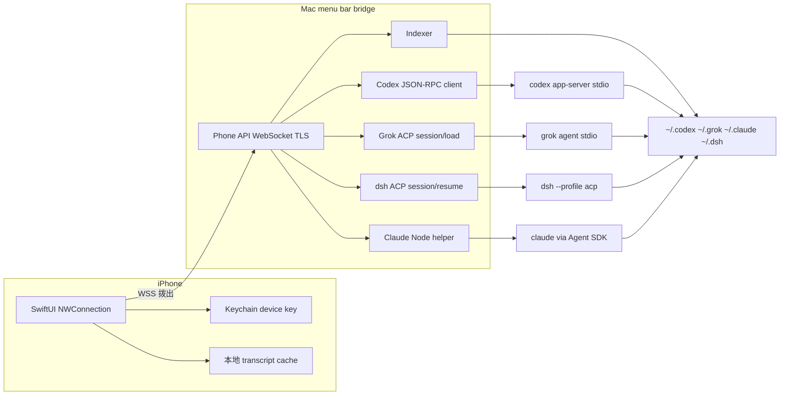
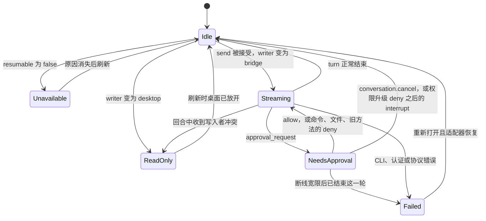
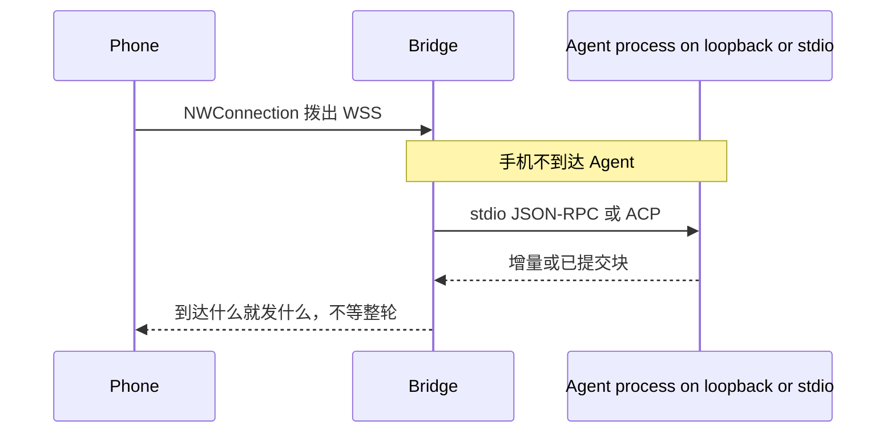
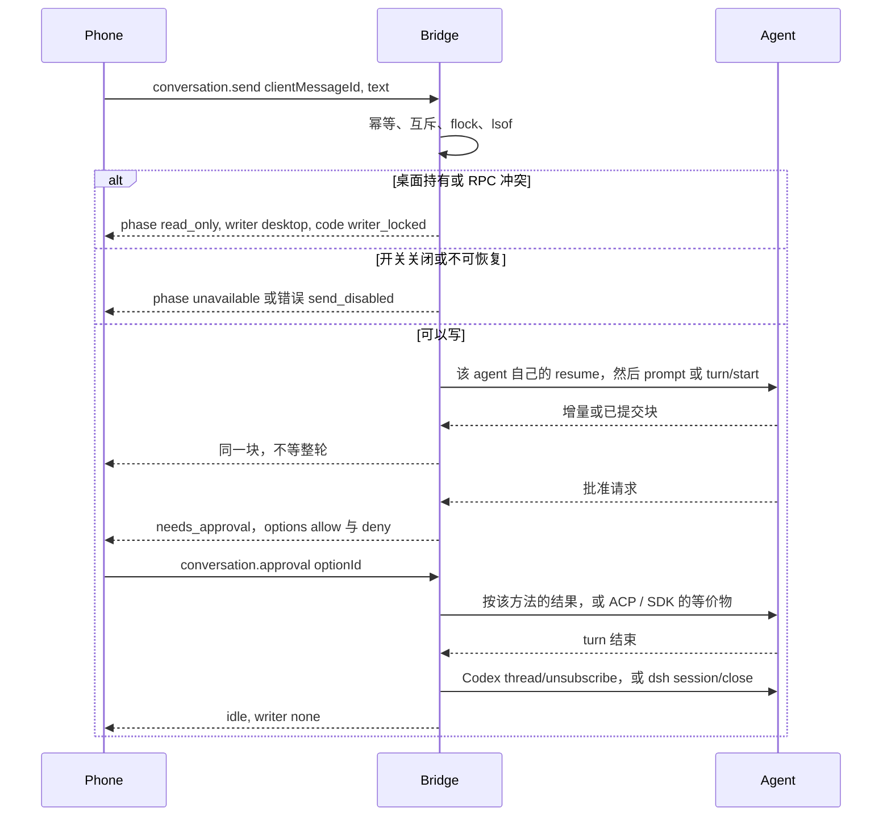

# genius-coder：个人 iPhone 多 Agent 编程会话客户端设计

| 字段 | 值 |
| --- | --- |
| Author | TBD |
| Date | 2026-10-29 |
| Status | Draft |
| 产品名 | genius-coder |
| 显示名 | genius-coder |
| Bundle id | `com.local.geniuscoder` |
| Bonjour | `_geniuscoder._tcp` |
| 最低系统 | macOS 15、iOS 18 |
| 范围 | 一台 Mac、一部 iPhone、四个已经装在 Mac 上的 coding agent |

## Overview

主人已经在 Mac 上用 Codex、Claude Code、Grok Build 和 DeepSeek Harness 写代码。会话散落在四套本机存储里，离开桌子就接不上下一轮。genius-coder 是一部 iPhone 上的交互式客户端：按项目列出全部历史会话，打开同一套对话界面（历史、输入、工具卡片、允许或拒绝），并把下一轮交给该 agent 自己的客户端协议，让 agent 恢复自己的上下文、轮次和权限。它不是一次性的 headless 任务投递器，也不是终端画面的镜像。显示名是 genius-coder。本文仍用「手机」和「bridge」指这两个进程。

Mac 上跑一个菜单栏 bridge。Bridge 只做三件事：把四套存储编成按目录分组的索引；为正在继续的会话拉起对应的官方客户端；向手机暴露稳定的 WebSocket JSON API。手机只跟 bridge 说话。Codex `app-server`、`grok agent serve`、Claude、`dsh` 都留在 stdio 或 loopback 上。家里走局域网加 Bonjour，出门走 Tailscale，两端都不开公网端口。

协议以这台机器上的二进制为准，不以更新的公开文档为准。Codex 钉死 `codex-cli 0.165.0-alpha.1.2` 的 `codex app-server generate-json-schema`。DeepSeek 钉死 DeepSeek Harness.app `0.2.1-rc.2` 里的 `dsh-acp` README。Grok 的继续方法仍是 README 里的 `session/load`。这三套恢复调用不能合成一个。

## Background & Motivation

四套会话今天都只能在 Mac 前继续：

- Codex 桌面和 VS Code 扩展走 `codex app-server`。线程在 `~/.codex/state_5.sqlite` 的 `threads` 表，正文在 rollout。`CODEX_HOME` 可以改根目录。
- Grok Build 的会话是目录 `$GROK_HOME/sessions/<encoded-cwd>/<session-id>/`。可显示的记录是 `updates.jsonl`，列表元数据是 `summary.json`。继续会话是 `grok agent stdio` 上的 ACP `session/load`，然后 `session/prompt`。
- Claude Code 的列表来源是 `~/.claude/projects/<project-slug>/<session-id>.jsonl`。`<session-id>` 是 `claude --resume` 接受的 UUID。slug 把工作目录里的非字母数字换成 `-`，含 `-` 的路径不能可靠还原。`cwd` 必须来自 JSONL 记录。2026-10-29 这台 Mac 上还没有这个目录，所以 v1 不猜测字段名。
- DeepSeek Harness 的会话在 `$DSH_HOME/sessions`（这台机器上是 `~/.dsh`）。日志是 append-only，后端不迁移旧格式。这台机器的 `dsh-acp` 用 `session/resume` 恢复，并且明确拒绝 `session/load`。

直接改这些文件来「续聊」会破坏 turn 计数、权限和压缩检查点。官方的远程控制也不覆盖这个产品：Claude Code Remote Control（`claude remote-control`、`/remote-control`、Claude iOS 的 Code tab）是去操纵一个已经打开的终端；Cursor 和 Copilot 的远程不在范围内。手机要的是「一个项目下全部历史会话，以及由本 app 重新打开的那一条的下一轮」。

2026-10-29 在这台 Mac 上核对过的事实（只读元数据，没有读取 `auth.json` 或其它凭据；没有做完一次活的 ACP 握手，因为 `dsh --profile acp` 第一次启动会创建 `~/.dsh/profiles/acp`）：

| 事实 | 观察 |
| --- | --- |
| Codex CLI | 不在 `PATH`。二进制是 `/Applications/ChatGPT.app/Contents/Resources/codex-cli/bin/codex`，版本 `codex-cli 0.165.0-alpha.1.2`。`app-server` 默认 `--listen stdio://`，也支持 `unix://` 和 `ws://`。方法名以该二进制的 `generate-json-schema` 为准。 |
| Codex 索引 | `state_5.sqlite` 的 `threads` 有 29 行，12 个不同的 `cwd`。全部 `archived = 1`，`history_mode = paginated`，`approval_mode = never`，`sandbox_policy = {"type":"disabled"}`。`project_id` 和 `attached_thread_parent_id` 全是 NULL。`thread_source`：17 条 `subagent`，1 条 `realtime_voice`，其余是 `user`。 |
| Codex 父子 | `thread_spawn_edges` 有 17 行：`parent_thread_id`、`child_thread_id`、`status`。`source` 列有时也嵌着同一父 id 的 JSON。父 id 以 `thread_spawn_edges` 为准。 |
| Codex 正文 | `~/.codex/sessions/` 下没有文件。29 个归档在 `~/.codex/archived_sessions/*.jsonl.zst`（压缩后约 24 MB，最大约 13 MB）。sqlite 的 `rollout_path` 写成缺失的 `*.jsonl`，旁边的 `.jsonl.zst` 才存在。写入者探测对这个兄弟文件做 `lsof`，见「写入者锁」。`zstd` 不在 `PATH`。`thread_history_1.sqlite` 是内部投影，bridge 不读。 |
| Codex 批准枚举 | `AskForApproval` 只有 `untrusted`、`on-request`、`never`，或一个 `granular` 对象。公开文档里的 `unlessTrusted` 不在这份 schema 里。`thread/resume.sandbox` 是连字符字符串 `read-only`、`workspace-write` 或 `danger-full-access`。`turn/start.sandboxPolicy` 是另一个类型，workspace-write 臂为 `{ "type": "workspaceWrite", "networkAccess": false, "writableRoots": [] }`。命令执行和文件变更的 `decision` 是 `accept` / `decline` / `cancel`。`item/permissions/requestApproval` 的结果是 `{ "permissions", "scope" }`，没有 `decision`。`execCommandApproval` 与 `applyPatchApproval` 的 `decision` 是 `ReviewDecision`（`approved`、`{ "denied": { "rejection" } }`、`abort`）。 |
| Codex 进程插座 | `~/.codex/ipc/ipc.sock` 存在。`thread-writer-locks/` 里只有 0 字节的 `.coordination.lock`，没有按线程的锁文件（当时没有活 turn）。`codex app-server proxy --sock` 能接到控制插座。`daemon enable-remote-control` 存在，本产品不调用它。 |
| Grok | `/Users/baigeitiancai/.grok/bin/grok`，版本 `1.0.70`。编码 cwd 目录下直接有 77 个会话目录，不是 76。`summary.json` 含 `info.id`、`info.cwd`、`generated_title`（77 条里 22 条为空）、`session_summary`、`updated_at`、`last_active_at`、少数 `git_root_dir`、`current_model_id`、`session_kind`、`parent_session_id`。`session_kind` 为 `subagent` 的 4 条、`subagent_resume` 的 12 条；12 条 summary 有 `parent_session_id`。这些是顶层目录，不是 `subagents/` 里的子目录。5 个会话没有 `updates.jsonl`，其中 2 个仍有 `chat_history.jsonl`。`updates.jsonl` 的行是 ACP `session/update`。锁文件是 0 字节。`leader.sock` 不存在。 |
| Grok `prompt_history.jsonl` | 有 3 个，位于 `~/.grok/sessions/<encoded-cwd>/`，和会话目录并列，不在会话目录里面。README 的 Session Persistence 不把它列为权威日志。它不是索引，也不是历史渲染输入。 |
| Claude Code | CLI `2.1.239` 在 `~/.local/share/node-v24.18.1/bin/claude`，不在 `PATH`。`~/.claude/projects` 不存在，`~/.claude/sessions` 是空的，也没有 `~/.claude/settings.json`。`~/Library/Application Support/Claude/claude-code-sessions` 是桌面应用的另一套目录，v1 不索引。 |
| dsh | 不在 `PATH`。二进制是 `/Applications/DeepSeek Harness.app/Contents/Resources/runtime/cli/bin/dsh`，版本 `0.2.1-rc.2`。`~/.dsh/sessions/<encoded-cwd>/session-<uuid>/` 下有 `session.v4.jsonl.zstd` 和 0 字节的 `session.lock`。日志头 `version` 是 4。projcache 的 `identity.formatVersion` 是 4。样本 `goal.current` 是 null。随包的 `dsh-acp` README 支持 `initialize`、`authenticate`（立即成功，不要凭据）、`session/new`、`session/list`、`session/resume`、`session/close`、`session/set_config_option`、`session/prompt`、`session/cancel`、`session/update`、`session/request_permission`。它点名 `session/load` 不支持、会被拒绝。`session/resume` 恢复日志且不重放旧的 update。update 是已经提交的助手消息和思考，原始 provider delta 不上线。一个 `dsh --profile acp` 进程可以同时持有多个会话。第一次启动某个随包 profile 会写出 `~/.dsh/profiles/<name>`（`web`、`headless`、`sdk`、`sdk-minimal`、`acp`）。 |

和先前口述不一致、以这台机器为准的几点：

1. dsh 的格式版本不是 0。这台机器是 version 4，文件名是 `session.v4.jsonl.zstd`。不迁移旧日志；解析不了就标成「能列出、不能继续」，索引整体不崩。
2. Grok 的 cwd 级 `prompt_history.jsonl` 存在。不把它当索引或历史。渲染 `updates.jsonl`。`chat_history.jsonl` 是送给模型的原文，同样不渲染。
3. dsh 的恢复方法是 `session/resume`，不是 Grok 的 `session/load`。v1 不用 `dsh --profile sdk` 做补救，因为那个 profile 是另一套 JSON-RPC，本文不发明它的方法名。
4. Codex 的批准策略值是 `on-request`。线上方法是斜杠名。`thread/resume.sandbox` 用 `"workspace-write"`。`turn/start.sandboxPolicy` 用 `{ "type": "workspaceWrite", "networkAccess": false, "writableRoots": [] }`。批准回复按服务器方法拆开，见活会话适配器。

GUI 进程拿不到登录 shell 的 `PATH`。Bridge 必须配置绝对路径。

## Goals & Non-Goals

### Goals

- 三级导航：项目 → 该项目下的会话 → 一个会话。
- 项目是一条规范工作目录，通常是 git 根。同一个目录只出现一次。四个 agent 的会话挂在它下面，并标上 agent。
- 筛选：全部 / Codex / Claude / Grok / DeepSeek。
- 在项目里新建会话时选择 agent，`cwd` 就是这个项目。
- 四个 agent 共用一个会话界面：历史、composer、工具卡片、允许或拒绝。
- 下一轮用户消息必须走该 agent 的客户端协议。会话文件只做索引和历史渲染。
- 一个会话同时只有一个写入者。桌面已经打开并正在跑时，手机只读，直到桌面放开。Bridge 在自己的 turn 期间一直占着进程内互斥；能 `flock` 的文件也一直占到 turn 结束。没有活 turn 证实桌面会去抢同一把锁之前，不把 `flock` 写成桌面协议。
- 手机主动拨出。Bridge 是唯一监听者。家里 TLS + 配对设备密钥 + Bonjour；出门只绑 Tailscale 的接口，地址落在 `100.64.0.0/10` 或 `fd7a:115c:a1e0::/48`。
- Turn 进行中，包括等待批准时，阻止 Mac 睡眠。
- 个人规模：一部手机、少量并发会话、几十 MB 的 JSONL。暖索引之后，局域网列出项目小于 1 秒。除了 dsh（见下），token 流不能攒完整条消息再发。dsh 的 ACP 只给已提交的块；bridge 在块到达时立刻转发，不等整轮结束，也不能把块拆成 token。
- 最低系统是 macOS 15 和 iOS 18。菜单栏 bridge 与 SwiftUI 手机 app 都按这个版本编译。

### Non-Goals

- PTY / TUI 镜像。
- 把 ngrok、Cloudflare Tunnel 或任何公网中继当默认路径。
- 在手机上跑 agent，多用户，账号体系，云数据库。
- 用 headless `claude -p` 或 `codex exec` 当作产品形态。
- 用 `dsh web`（`127.0.0.1:3080`，URL 里带进程 token）、`dsh --profile headless` 或 `dsh --profile sdk` 当作产品形态。
- 官方 per-vendor remote control，包括 Claude Code Remote Control、Cursor remote、Copilot remote。
- 手机直接连接 `codex app-server` 的 WebSocket、`grok agent serve` 或 `~/.grok/leader.sock`。
- v1 的 APNs、附件和图片、会话 fork、改标题、归档按钮。`thread/fork`、`thread/archive`、`thread/name/set` 只留名。
- 索引 Claude 桌面应用 `Application Support` 里的会话。
- 在没有真实 JSONL fixture 之前猜测 Claude 会话文件的字段。
- Prompt injection 的专门防御。Agent 能跑 shell；边界是手机上的批准，不是试图过滤模型输出。

## Key Decisions

1. **手机协议和 agent 协议分开。** 手机只说本文的 WebSocket JSON。CLI 升级只打坏一个适配器。Codex 的线上 JSON-RPC 不带 `"jsonrpc":"2.0"`；ACP 带。手机看不到这个差别。
2. **历史可以读，续聊必须走官方客户端，而且各家的「打开」和「恢复」不是同一个调用。** 打开永远不调用 `thread/resume`、`session/load`、`session/resume` 或 Agent SDK 的 `resume`。Codex 的历史走已经拉起的 app-server 上的 `thread/read`（不要 `includeTurns`）、`thread/turns/list` 和 `thread/items/list`。Grok 的历史读 `updates.jsonl`。dsh 的历史只读磁盘，因为 `session/resume` 不重放旧 update。Claude 的历史解析器等 fixture。发送时：Codex 先按需要 `thread/unarchive`，再 `thread/resume` 和 `turn/start`；Grok 是 `session/load` 再 `session/prompt`；dsh 是 `session/resume` 再 `session/prompt`；Claude 是 SDK streaming input 的 `resume`。任何路径都不追加 JSONL 或 rollout。
3. **Grok 用 bridge 自己的 `grok agent stdio`，不用 `grok agent serve`，也不附着 `leader`。** stdio 没有端口和 `GROK_AGENT_SECRET`。`serve` 的默认绑定 `127.0.0.1:2419` 留在机器上给别人用，bridge 不连它。
4. **Claude 用 Agent SDK，不用 ACP adapter 做主路径。** `@agentclientprotocol/claude-agent-acp` 是跟着 CLI 走的第二层翻译。支持的恢复 API 是 SDK：`query()` 的 streaming input、`options.resume`、`permissionMode: "default"`、`settingSources: ["user", "project"]` 和 `canUseTool`。Grok 与 dsh 只共用换行 JSON-RPC 的读写，不共用恢复方法。Codex 是另一套不带 `"jsonrpc"` 字段的 JSON-RPC。不为了形式统一把 Claude 塞进 ACP。
5. **Claude SDK 用 bridge 拉起的 Node helper，helper 有自己的 stdio 协议。** 包是 `@anthropic-ai/claude-agent-sdk`，用本机 Node 运行（这台机器是 `~/.local/share/node-v24.18.1/bin/node`）。`package.json` 必须钉到与 Claude Code `2.1.239` 匹配的 SDK 版本；仓库里没有这个版本就不浮动 `latest`，Claude 发送开关保持关闭。`pathToClaudeCodeExecutable` 指向绝对路径。这不是 `claude -p`。
6. **Codex 由 bridge 自己拉起一个 `codex app-server --listen stdio://`，不代理进桌面的 `ipc.sock`。** 桌面那个进程拥有批准弹窗和 remote-control 注册。适配器只认 `0.165.0-alpha.1.2` 的 schema。`approvalPolicy` 用 `"on-request"`。`thread/resume.sandbox` 只用连字符字符串 `"workspace-write"`。`turn/start.sandboxPolicy` 是对象 `{ "type": "workspaceWrite", "networkAccess": false, "writableRoots": [] }`。存储里的 `never` 和 `{"type":"disabled"}` 不继承。批准没有一套适用于全部方法的 `accept` / `decline` / `cancel`：命令执行和文件变更用这三个 `decision`；`item/permissions/requestApproval` 只回 `{ "permissions", "scope": "turn" }`；旧的 `execCommandApproval` 和 `applyPatchApproval` 用 `approved`、`{ "denied": { "rejection" } }` 和 `abort`。空闲时 `thread/unsubscribe`，避免一条发送把线程在 bridge 的 app-server 里占到退出。
7. **dsh 主路径是 `dsh --profile acp` 的 `session/resume`，v1 没有 SDK profile 回退。** 二进制默认路径是 `/Applications/DeepSeek Harness.app/Contents/Resources/runtime/cli/bin/dsh`。索引以磁盘为准。`session/load` 被这份 `dsh-acp` 拒绝，调用它就是错误，不是回退条件。一个 dsh 进程持有多个会话；空闲用 `session/close` 刷盘，而不是直接杀进程。第一次启动可以创建 `~/.dsh/profiles/acp`，这是已知副作用，不是崩溃。
8. **dsh 的 armed goal 在 `session/resume` 之后保持解除。** Bridge 不发送任何「继续 goal」的调用。`session/resume` 返回后、第一次 `session/prompt` 之前，如果 agent 自己开始干活，bridge 发 `session/cancel`。这份 README 写明：没有 prompt 在飞时，`session/cancel` 取消自主工作。会话进入 `failed`，错误码 `goal_rearmed_blocked`。
9. **项目身份是规范路径，不是某一家的 slug，也不是 Codex 的 `projects` 表。** 这台机器上 `threads.project_id` 全空。允许列表是规范绝对目录，按路径分量匹配，不是字符串前缀。菜单栏第一次启动询问一次。确认后，把 Codex、Grok、dsh 会话存储里已经出现的规范 `cwd` 种进允许列表。拒绝则列表保持为空，并且不再询问。
10. **两端都用 Swift，产品名是 genius-coder。** 显示名 genius-coder。Bundle id 是 `com.local.geniuscoder`。Bonjour 类型是 `_geniuscoder._tcp`。菜单栏 bridge 目标 macOS 15，SwiftUI 手机 app 目标 iOS 18。两端共用一个 Swift package 里的消息类型。手机插座是 `NWConnection` 加证书钉扎，不是 `URLSession`。替代方案是 Go 或 Rust bridge，见 Alternatives。v1 不采用。
11. **v1 没有 APNs。** 进后台后 iOS 挂起长连接。用户重新打开 app 才看到期间的更新。批准在单调时钟的 15 秒宽限之后失败关闭，按当时悬着的那一条服务器请求结束这一轮，不自动允许。Codex：命令执行和文件变更回 `{ "decision": "cancel" }`；`item/permissions/requestApproval` 回 `{ "permissions": {}, "scope": "turn" }` 再 `turn/interrupt`；`execCommandApproval` 和 `applyPatchApproval` 回 `{ "decision": "abort" }`。ACP 送 `session/cancel`。Claude 送 `{ "behavior": "deny", "message": "phone disconnected", "interrupt": true }`。`acceptForSession`、`approved_for_session` 和 `scope: "session"` 都不发送。
12. **v1 只有一个有效配对设备。** 再次配对会替换旧设备密钥。菜单栏可以撤销。
13. **发送开关默认关闭，而且不能先于该 agent 的安全路径。** 某个 agent 的 `conversation.send` 只有在同一批改动里同时具备批准映射、写入者排除、`caffeinate`、追赶环和断线失败关闭时，才允许被菜单栏打开。合并之后开关仍默认关。

## Proposed Design

### 系统边界



手机不连接下面任何一个：`ws://` 上的 app-server、`grok agent serve`、`leader.sock`、`dsh web`、Claude remote-control。

### 手机界面

1. **配对。** 扫菜单栏上的一次性二维码。完成前没有项目列表。真机要能在局域网或 Tailscale 上完成，不能只在 Mac 的 loopback 上自测。
2. **项目。** 每行是规范路径的最后一段；重名时加上一级父目录。右侧是各 agent 的会话数。顶部筛选：全部 / Codex / Claude / Grok / DeepSeek。选中某个 agent 时，没有该 agent 顶层会话的项目不出现。空项目只来自允许列表里的 git 扫描，并标「无会话」。下拉刷新会向 bridge 要一次索引。
3. **会话。** 进入一个项目后按 `updated_at` 倒序。每行有 agent 徽章、标题、时间。子 agent 不占顶层行，收在父会话下面，v1 只显示、不能单独续聊。Codex 的父 id 来自 `thread_spawn_edges`，不是 `attached_thread_parent_id`（这台机器上那一列全空）。Grok 的 `session_kind` 为 `subagent` 或 `subagent_resume` 时，父 id 是 `parent_session_id`。`realtime_voice` 同样不可续聊。没有 `updates.jsonl` 的 Grok 会话仍列出，历史为空。
4. **新建。** 项目页的按钮先问 agent。二进制解析失败的灰掉并写原因。`cwd` 固定为该项目的规范路径。对应 agent 的发送开关关闭时，新建也灰掉。
5. **会话页。** 历史气泡、思考块（默认折叠）、工具卡片、diff 卡片、composer。`conversation.open` 返回的 `events` 是最新一页，数组按时间正序：最旧在前，最新在后。`olderCursor` 向更旧的页走。工具输出超过 32 KiB 只给预览。dsh 的助手文本是一整块已提交内容，原样显示，不假装有 token 动画。Composer 在 `streaming`、`needs_approval`、`read_only`、`unavailable`、`disconnected`、`failed` 时停用。
6. **批准。** 模态卡片。按钮是 bridge 给出的 `allow` 和 `deny`。不展示、也不回传「本次会话总是允许」。Codex 侧丢掉 `acceptForSession`、`approved_for_session` 和 `scope: "session"`。手机仍只回 `optionId`。
7. **连接状态。** 常驻在项目页：`LAN`、`Tailscale` 或 `断开`。断开时仍可翻本地缓存，不能发送。
8. **打开锁。** 打开 genius-coder 时默认要求 Face ID，设备没有面容时用设备密码。通过之后才进入配对页或项目列表。设置里可以关掉这道锁。关掉之后，已解锁的手机可以直接进入 app。

允许列表的编辑在 Mac 菜单栏，不在手机上。手机设置做四件事：Face ID 开关（默认开）、忘记此设备、清空缓存、手动填写 bridge 主机。

### 会话状态机

连接和会话阶段是两层。连接只有 `connected` 和 `disconnected`。`writer` 只有 `none`、`bridge`、`desktop`、`unknown`。打开之后、发送之前，写入者不是 `bridge`。



没有 `failed` → `read_only`。`writer_locked` 只进入 `read_only`。`cli_missing`、坏日志、子 agent、`realtime_voice`、Claude 还没有 fixture，进入 `unavailable`，错误码留在 `resumableError`。刷新只能清掉 `read_only`。`unavailable` 要等二进制出现、日志变得可读，或 fixture 落地。

`disconnected` 叠在任何阶段上：

- 正在 `streaming` 时挂起：Mac 上的 turn 继续，`caffeinate` 还在。Bridge 为这条会话留一个追赶环（最多 2000 个事件或 8 MiB，先到为准）。手机回来后按 `seq` 补上；环溢出就重做 `conversation.open`。
- 正在 `needs_approval` 时挂起：用单调时钟保留 15 秒。重连就重新推送同一张卡片。超时则失败关闭，阶段 `failed`，错误码 `approval_denied_disconnected`。Codex 按悬着的方法结束这一轮：命令执行和文件变更回 `{ "decision": "cancel" }`；权限升级回空授予 `{ "permissions": {}, "scope": "turn" }` 再 `turn/interrupt`；旧方法回 `{ "decision": "abort" }`。ACP 送 `session/cancel`。Claude 的 `PermissionResult` 是 `{ "behavior": "deny", "message": "phone disconnected", "interrupt": true }`。命令执行上的 `decline` 会让这一轮在手机不在时继续，断线路径不用它。
- `read_only` 和 `unavailable` 在断线期间保持各自的含义。

| 阶段 | 进入条件 | writer | Composer |
| --- | --- | --- | --- |
| `idle` | 已打开，没有进行中的 turn，桌面没占着 | `none` | 可发送，但该 agent 的开关要开着 |
| `streaming` | bridge 已把本轮交给 agent | `bridge` | 停用；可取消 |
| `needs_approval` | bridge 驱动的 turn 上有未回答的批准。这不是空闲 | `bridge` | 停用；只显示批准卡片 |
| `read_only` | 桌面持有写入者 | `desktop` | 停用。历史仍可刷新 |
| `unavailable` | `resumable = false` | `none` | 停用。不是锁 |
| `failed` | 适配器报错，且不是锁 | `none` 或仍为 `bridge` 直到进程收掉 | 停用；可重试打开 |

列表接口上的 `writer` 保持 `unknown`，因为列表不做锁探测。`conversation.open` 做一次探测：没人占着就是 `none`，桌面占着就是 `desktop` 且阶段 `read_only`。只有 `conversation.send` 成功占锁之后才变成 `bridge`。

取消只作用于 bridge 自己的 turn。批准还悬着时，`conversation.cancel` 先按该方法的结束响应回答，然后阶段 `idle`。命令执行和文件变更的结束响应是 `{ "decision": "cancel" }`。旧方法是 `{ "decision": "abort" }`。权限升级是空授予再加上 `turn/interrupt`。没有悬着的服务器请求时，Codex 用 `turn/interrupt`。ACP 用 `session/cancel`。Claude helper 用 `session.interrupt`，对应 SDK `interrupt()`。取消不是去杀桌面的 TUI。

手机上的 Deny 和取消不是一回事。Deny 的 `optionId` 是 `"deny"`。命令执行、文件变更和旧的 `ReviewDecision` 拒绝之后，turn 继续，阶段回到 `streaming`。`item/permissions/requestApproval` 的拒绝会结束这一轮，阶段回到 `idle`，因为该结果类型表达不了 `decline`。ACP 映射为该权限请求的拒绝结果，turn 按 agent 的拒绝语义继续。`conversation.cancel` 才是用户要求结束整轮。

### Mac 进程模型

一个用户态菜单栏 app（SwiftUI `MenuBarExtra`，`LSUIElement`）。`SMAppService` 只注册登录项，没有 `KeepAlive`。用户退出之后保持退出，直到下次登录。不是 root daemon，也不是第二个常驻进程。

每个 agent 子进程在 bridge 拥有的进程组里启动（`setsid`）。Application Support 里记着这些进程组 id。启动之后、接受任何 `conversation.send` 之前，bridge 先回收上次崩溃留下的进程组：`SIGTERM`，等 3 秒，再 `SIGKILL`。菜单栏崩溃或 bridge 被 `SIGKILL` 时，子进程会被 launchd 收养；下一次启动必须先收掉它们，否则会看到别人占着的 Codex 线程或 Grok 锁，把手机卡死在 `read_only`，或者两个司机一起写。

正常退出用同一套排水：先做下面的空闲关闭，再 `SIGTERM`，3 秒后 `SIGKILL`。用户在 turn 中途退出时，不修 JSONL。手机下次连上看到 `adapter_failed`，历史从官方存储重新打开，缺的半截就缺着。

| 角色 | 数量 | 生命周期 |
| --- | --- | --- |
| 菜单栏 UI、配对、允许列表 | 1 | app 生命周期 |
| TLS 监听和 Bonjour | 每块启用的网卡一个 `NWListener` | app 生命周期 |
| Indexer | 1 | 启动后常驻，FSEvents 去抖 1 秒 |
| Codex `app-server --listen stdio://` | 最多 1 | 第一次 Codex 的 `conversation.open` 或发送时拉起。打开只用只读 RPC。发送才 `thread/unarchive`（若仍归档）和 `thread/resume`。回到 `idle` 时 `thread/unsubscribe`。进程可以留着，线程不能留在内存里直到退出。 |
| `grok agent stdio` | 每个正在继续的 Grok 会话 1 个，全局最多 4 | 发送时拉起。`streaming` 和 `needs_approval` 都不算空闲。两者都结束后 10 分钟，关掉进程组。 |
| Claude Node helper，以及它拉起的 `claude` | 每个正在继续的 Claude 会话 1 个，全局最多 4 | 同上。空闲时先让 helper 结束 query，再排水。 |
| `dsh --profile acp` | 1 个进程，里面最多 4 个活会话 | 第一次 DeepSeek 发送时拉起。空闲会话调用 `session/close` 刷盘。活会话数为 0 之后，再按 `SIGTERM` 排水关掉进程。不按会话各起一个 dsh。 |

第五个活会话得到 `too_many_live_sessions`，不抢占已有的。

打开 Grok 或 dsh 不拉起进程。打开 Codex 可以拉起 app-server，但只为了 `thread/read`、`thread/turns/list` 和 `thread/items/list`。打开 Claude 在 fixture 落地之前不拉起 helper。

`caffeinate` 从第一条会流式输出的 agent 改动就接上，不留到最后。`/usr/bin/caffeinate -im -w <bridge-pid>` 在任一会话处于 `streaming` 或 `needs_approval` 时持有，两个阶段都结束才关掉。v1 不负责唤醒已经睡下去的 Mac。

二进制解析顺序：菜单栏里的覆盖路径；否则探测下面的绝对路径。GUI 不继承 Terminal 的 `PATH`。不把「`which` 失败」当成这台机器上没有 dsh。

- Codex：`/Applications/ChatGPT.app/Contents/Resources/codex-cli/bin/codex`
- Grok：`~/.grok/bin/grok`，`GROK_HOME` 默认 `~/.grok`
- Claude：`~/.local/share/node-v24.18.1/bin/claude`，旁边的 `node` 跑 helper
- dsh：`/Applications/DeepSeek Harness.app/Contents/Resources/runtime/cli/bin/dsh`，`DSH_HOME` 默认 `~/.dsh`

### 网络



- 家里：监听当前 Wi-Fi 的局域网地址，不用 `0.0.0.0`。Bonjour 类型 `_geniuscoder._tcp`。TXT 只放 `bridgeId` 和证书指纹的前缀，不放配对 token。家用路由器不转发这个端口。局域网仍不可信。
- 出门：Mac 和 iPhone 都在个人 Tailscale 里。额外的监听绑在 Tailscale 接口上。若认不出接口，只接受 `100.64.0.0/10` 里的 IPv4，以及存在时的 Tailscale IPv6 `fd7a:115c:a1e0::/48`。不把任意 `100.*` 都当成 Tailscale。没有端口转发，没有公网监听。
- 手机 Info.plist 必须有 `NSLocalNetworkUsageDescription`（说明要在本地网络上发现这台 Mac）和 `NSBonjourServices`（`_geniuscoder._tcp`）。插座是 `NWConnection`。TLS 信任回调只接受钉住的那张 ECDSA P-256 证书，比较证书的 SHA-256。不用 `URLSession`，不加 ATS 例外。
- 两个监听开关在菜单栏，发现到对应接口就默认开。macOS 防火墙第一次会问是否允许入站。
- mDNS 不过 Tailscale。二维码里同时写 LAN 主机和 Tailscale 主机（IPv4 与 IPv6，有哪个写哪个）。手机先用上次成功的地址；局域网浏览 2 秒失败再用保存的 Tailscale 地址。
- 端口从 8787 起，占用则试到 8797。

配对：

1. 菜单栏生成一次性 token（32 字节，SHA-256 后只留在内存）。有效期 5 分钟，用 bridge 进程内的单调时钟（`ContinuousClock`）从生成时刻量起，不用墙上时钟。Bridge 一重启，token 就没了。
2. 二维码内容是 JSON：`v`、`bridgeId`、`fp`、`hosts[]`、`port`、`token`。可以带一个给人看的 `exp`，鉴权不看它。
3. 手机生成 Ed25519 密钥，私钥进 Keychain（`kSecAttrAccessibleAfterFirstUnlockThisDeviceOnly`，不同步 iCloud）。用钉住的证书连上 TLS，交出 token 和公钥。
4. Bridge 核销 token，把公钥写成唯一有效设备。旧设备立即失效。
5. 之后的连接：TLS 1.3 钉扎，再签一次 nonce。Nonce 是 32 个原始字节，线上用 base64url。有效期 60 秒，同样从发出时刻的单调时钟量起，单次。签名输入是这 32 个原始字节直接拼接 `bridgeId` 的 UTF-8 字节，没有长度前缀。`deviceId` 不在签名字节里；它用来选出公钥，并且必须等于已登记的那一个。

证书是 app 首次启动时生成的 ECDSA P-256 自签证书，文件权限 `0600`。菜单栏「重新生成证书」会使指纹失效，必须重新配对。

v1 没有推送。进后台后长连接被系统挂起。重新打开 app 时走追赶环或重新打开会话。

### Indexer

索引只读元数据，不扫完整份 JSONL。目标：这台机器的冷索引（29 条 Codex、77 条 Grok、0 条 Claude、1 条 dsh）在 2 秒内完成；暖索引之后，局域网 `projects.list` 在 1 秒内回到手机。

规范路径：

```text
canonical(cwd):
  real = realpath(cwd)
  real = 去掉末尾的 /，但保留 "/"
  if real 不存在: 仍返回 real，项目标 missing
  top = git -C real rev-parse --show-toplevel   // 超时 500ms
  if top 成功且 top 是 real 的祖先: 返回 realpath(top)
  else 返回 real
```

不把 Codex subagent 的容器 `cwd`（出现过 `/root/...`）拿来建项目，除非该路径真实存在于这台 Mac 并且通过允许列表。只有顶层用户会话的 `cwd` 建项目。

允许列表存在菜单栏配置里。每一项必须是 `realpath` 之后的绝对目录。拒绝相对路径。拒绝 `/`，除非用户在对话框里明确确认，并且配置里写上 `allowRoot: true`。匹配在规范路径上做：候选等于根，或者候选以「根 + `/`」开头。因此 `/Users/me/code` 包含 `/Users/me/code/repo`，不包含 `/Users/me/code-evil` 或 `/Users/me/code.bak`。这个用例要有单元测试。

默认没有「扫整个家目录」。genius-coder 菜单栏第一次启动显示一次确认。确认后，收集 Codex `threads.cwd`、Grok `summary.json` 的 `info.cwd`、以及 dsh 会话目录所代表的 cwd，各自做上面的规范路径，去重后写入允许列表，`seededFromSessions` 为 true。拒绝则 `roots` 保持空，`seededFromSessions` 保持 false，并记下已经问过，之后不再弹出。Claude 不参加这次播种：这台机器没有 `~/.claude/projects`，也不从 slug 猜 `cwd`。可选的 git 扫描只走允许列表。允许列表之外的会话不显示，也不删除。

项目 id 是 `proj_` 加规范路径的 SHA-256 前 16 个十六进制字符。会话 id 是 `codex:<thread-id>`、`grok:<session-id>`、`claude:<uuid>`、`deepseek:<session-id>`。

父会话：

- Codex：`parent_conversation_id` 来自 `thread_spawn_edges.child_thread_id → parent_thread_id`。没有边时，才解析 `threads.source` 里的 JSON。不用 `attached_thread_parent_id`。`status` 只做显示，不决定能不能续聊。子 agent 的 `resumable = false`。
- Grok：`session_kind` 是 `subagent` 或 `subagent_resume` 时，`parent_conversation_id` 来自 `parent_session_id`，并且不出现在顶层列表。`subagents/` 目录同样不单独成行。
- dsh 和 Claude：v1 没有见到可核实的父子字段之前，不发明父子行。

| 字段 | Codex | Grok | Claude | DeepSeek |
| --- | --- | --- | --- | --- |
| 原生 id | `threads.id` | `summary.json` 的 `info.id` | 有 fixture 之后才是 JSONL 文件名的 UUID | 目录 `session-<uuid>` |
| 标题 | `name`，否则 `title`，否则截断的 `preview`，否则 id 前缀 | `generated_title`，否则非空的 `session_summary`，否则 id 前缀。空标题是正常情况 | fixture 落地之前不解析 | projcache `rows.title.val`；没有则 id 前缀 |
| cwd | `threads.cwd` | `info.cwd`。`git_root_dir` 是祖先时，项目键用 git 根 | 只来自 fixture 里证实过的 `cwd` 字段。不用 slug 反推 | projcache `identity.cwd` 或日志头 `cwd`。不用目录名反推 |
| updated_at | `updated_at_ms` | `updated_at`，否则 `last_active_at` | fixture 落地前没有行 | `rows.sessionListMetadata.lastPromptAt`，否则日志头 `createdAt`，否则文件 mtime |
| archived | `threads.archived`。全部为 1 仍然列出，仍然可续聊 | 无归档位 | 不自己做保留期。这台 Mac 没有 `settings.json`，不读取也不发明 `cleanupPeriodDays`。文件被 Claude 删掉后行自然消失 | `workspace.json` 的 `archivedSessionIds` 只做徽章 |
| resumable | 二进制存在，且不是 subagent / `realtime_voice`。`archived = 1` 不等于不能续聊 | 二进制存在。没有 `updates.jsonl` 仍然 `resumable = true`，历史为空，`resumableError = null`，打开时 `detail = empty_history`。不读 `chat_history.jsonl` 来补历史 | fixture 落地前没有可恢复行 | 日志头 `version` 在 `{4}` 内，且 dsh 二进制存在。继续方法是 `session/resume`，不是 `session/load` |
| 来源路径 | 索引只记 `rollout_path` 和它的 `.zst` 兄弟是否存在。bridge 不解压 | 会话目录 | `~/.claude/projects/<project-slug>/<session-id>.jsonl`。目录不存在等于零行 | `session.v*.jsonl.zstd` 加 projcache |

Codex 历史不走文件解析器。Rollout 记录是 `{type, payload, timestamp, ordinal}`，`type` 见过 `session_meta`、`world_state`、`turn_context`、`event_msg`、`response_item`，payload 见过 `message`、`reasoning`、`custom_tool_call`、`item_completed`。这些不是手机事件。映射由 app-server 完成。bridge 不调用 `zstd`，不链接 zstd 去读 Codex，不读 `thread_history_1.sqlite`。`thread/read` 的 `includeTurns` 在 `history_mode = paginated` 上已废弃；29 行全是 paginated。

dsh 的历史要读 zstd 日志，因为 `session/resume` 不重放。用链接进 bridge 的 zstd 库，不用 `PATH` 上的 `zstd`。优先读 projcache。projcache 损坏再读日志头。头不是 JSON、`version` 不在白名单、或解不开：一行，`resumable = false`，`resumable_error = session_unreadable` 或 `unsupported_session_version`，阶段将是 `unavailable`，索引继续。

Claude：目录缺失就是零行。目录如果在 fixture 之前出现，只把文件记成 `unavailable`，`resumable_error = claude_history_needs_fixture`，不从 slug 猜项目，不把它们并进已有项目。子目录的预期位置是 `~/.claude/projects/<project-slug>/<session-id>/subagents/` 和同级的 `tool-results/`。这和「slug 下面才是 session 文件」一致；旧稿里少写的 slug 作废。第一份真实会话出现时先核对这个路径，再决定要不要索引子目录。子目录即使存在也不进顶层列表。

索引缓存是 bridge 自己的 SQLite。FSEvents 监视 `~/.codex`、`~/.grok/sessions`、`~/.claude/projects`、`~/.dsh/sessions` 和 projcache。

### 活会话适配器

#### Codex

传输：一个子进程，`codex app-server --listen stdio://`。按行 JSON-RPC，不写 `"jsonrpc":"2.0"`。不使用 `--listen ws://`。

`initialize` 必须带 `clientInfo.name` 和 `clientInfo.version`（bridge 的名字和版本）。只写名字不够。

打开（不恢复）：

1. 若 app-server 没在跑，拉起它。
2. `thread/read`，只要元数据，不设 `includeTurns`。
3. `thread/turns/list` 和 `thread/items/list` 取最新一页。分页参数以这份 `generate-json-schema` 为准。
4. 若第 3 步因为线程仍归档而失败，调用一次 `thread/unarchive` 再试一次。这一步是打开路径上唯一允许的官方写操作，而且只有 RPC 拒绝归档线程时才发生。历史 PR 必须记下这台 `0.165.0-alpha.1.2` 实际走了哪一边，不能同时留着「解析 zstd」和「不拉起 app-server」两种实现。
5. 不调用 `thread/resume`。

发送：

1. 占住写入者（见下节）。失败则 `read_only`，到此为止。
2. 若 `archived` 仍为 1，先 `thread/unarchive`，再 `thread/resume`。`thread/resume` 带 `sandbox: "workspace-write"`。不传 `danger-full-access`，不省略 sandbox。29 行存储的 sandbox 都是 `{"type":"disabled"}`，省略等于继续无沙箱。
3. `turn/start` 带用户文本、`approvalPolicy: "on-request"`、`clientUserMessageId`（等于手机的 `clientMessageId`），以及对象

```json
"sandboxPolicy": { "type": "workspaceWrite", "networkAccess": false, "writableRoots": [] }
```

`type` 必填。`networkAccess` 保持 `false`，`writableRoots` 保持空数组。这个对象和 `thread/resume.sandbox` 的字符串 `"workspace-write"` 不是同一个类型。`untrusted` 只是备选，v1 不用它，避免和「每次工具都问手机」差一档。`unlessTrusted`、`never`、`granular` 都不发送。
4. 若策略字段被拒绝，阶段 `failed`，错误码 `adapter_failed`。存储里的 `never` 不能作为重试。那样手机批准不会出现，而无沙箱执行会留下。
5. 回到 `idle` 时 `thread/unsubscribe`，然后释放写入者。

取消：没有悬着的服务器请求时用 `turn/interrupt`。有悬着的请求时先按下表回应该方法的结束响应。权限升级在空授予之后再 `turn/interrupt`。

必须订阅的线上方法（斜杠名，不是类型名）：

| 线上方法 | 手机事件 |
| --- | --- |
| `item/agentMessage/delta` | `assistant_text_delta` |
| `item/reasoning/textDelta`、`item/reasoning/summaryTextDelta` | `thinking_delta` |
| `item/commandExecution/requestApproval`、`item/fileChange/requestApproval`、`item/permissions/requestApproval` | `approval_request` |
| `execCommandApproval`、`applyPatchApproval` | 同上，旧方法名 |
| `turn/diff/updated`、`item/fileChange/patchUpdated` | `diff` |
| `thread/tokenUsage/updated` | `usage` |

命令输出和 item 生命周期的方法名也从同一份 schema 抄，映射到 `tool_call` 和 `tool_result`。不要监听 `AgentMessageDelta` 或 `CommandExecutionRequestApproval`，线上没有这些字符串。

手机 `optionId` 按服务器方法翻译。下表的 JSON 是该请求的 `result`，沿用这条线路不写 `"jsonrpc"` 的习惯。

| 服务器方法 | 手机 `allow` | 手机 `deny` | `conversation.cancel` 与断线超时 |
| --- | --- | --- | --- |
| `item/commandExecution/requestApproval`、`item/fileChange/requestApproval` | `{ "decision": "accept" }`。阶段回 `streaming` | `{ "decision": "decline" }`。turn 继续，阶段回 `streaming` | `{ "decision": "cancel" }`。schema 写明 turn 会被打断。取消后 `idle`；断线后 `failed` |
| `item/permissions/requestApproval` | `{ "permissions": <params.permissions>, "scope": "turn" }`。原样拷贝请求里的 profile。阶段回 `streaming` | 空授予，然后 `turn/interrupt`。见下段 | 同一空授予，然后 `turn/interrupt`。取消后 `idle`；断线后 `failed`，`approval_denied_disconnected` |
| `execCommandApproval`、`applyPatchApproval` | `{ "decision": "approved" }`。阶段回 `streaming` | `{ "decision": { "denied": { "rejection": "denied" } } }`。turn 继续，阶段回 `streaming` | `{ "decision": "abort" }`。取消后 `idle`；断线后 `failed` |

命令执行和文件变更的响应里可以出现的还有 `acceptForSession`、`acceptWithExecpolicyAmendment`、`applyNetworkPolicyAmendment`。这三项 v1 不发送，手机上也不做对应按钮。旧方法的 `ReviewDecision` 里还有 `approved_for_session`、`approved_execpolicy_amendment`、`approved_mcp_policy_amendment`、`network_policy_amendment` 和 `timed_out`，同样不发送。旧方法的 `decision` 不是 `accept`、`decline` 或 `cancel`。

`item/permissions/requestApproval` 的结果类型是 `PermissionsRequestApprovalResponse`：必填字段只有 `permissions`（`GrantedPermissionProfile`），`scope` 的枚举是 `turn` 或 `session`，默认 `turn`。没有 `decision`。`GrantedPermissionProfile` 的 `fileSystem` 和 `network` 都可省略，所以 `{ "permissions": {}, "scope": "turn" }` 能通过 schema，并且不授予额外文件系统或网络。这个空对象不是拒绝动词：服务器可以把任意成功响应当成「按请求里的 profile 升级」。因此 v1 选定的失败关闭是这一条，不是两条里挑一条实现：先回空授予，让这条 JSON-RPC 有结果，立刻再 `turn/interrupt`。手机 Deny 之后阶段是 `idle`（用户拒绝了升级，这一轮结束）。请求里的 profile 缺失或不是对象时，`allow` 走同一条失败关闭，不另造 profile。`scope` 只写 `"turn"`。`strictAutoReview` 不设置。

同一 PR 里，其它服务器请求到达就回答。它们不转成手机上的 `approval_request`，也不像未知的 Grok `sessionUpdate` 通知那样丢掉。Grok 丢掉的是不需要 `result` 的通知。

| 服务器方法 | 失败关闭 |
| --- | --- |
| `item/tool/requestUserInput` | `result` 为 `{ "answers": {} }`。不为任何 question id 填写字符串，包括 `isSecret`。空 map 通过 schema，但不是拒绝动词，接着 `turn/interrupt`。阶段 `failed`，错误码 `unsupported_server_request` |
| `mcpServer/elicitation/request` | `result` 为 `{ "action": "decline" }`，省略 `content`。`decline` 是该枚举里的拒绝，不送 `accept`。断线宽限耗尽时若这条仍未回答，改为 `{ "action": "cancel" }` 并 `turn/interrupt`，阶段 `failed`，`approval_denied_disconnected` |
| `item/tool/call` | `result` 为 `{ "success": false, "contentItems": [] }`。bridge 不执行这个客户端工具。断线宽限耗尽时若仍未回答，同一 `result` 再 `turn/interrupt` |
| `account/chatgptAuthTokens/refresh`、`attestation/generate` | 成功 `result` 必须带 `accessToken` 或 `token`。不读凭据文件，不编造这两个字符串。回应 `{ "id": <同一个请求 id>, "error": { "code": -32000, "message": "refused" } }`。有进行中的 turn 时再 `turn/interrupt`，阶段 `failed`，`unsupported_server_request` |
| 这份 `ServerRequest` 以外的服务器请求 | 同上，`error.code` 为 `-32000`，`message` 为 `"refused"`，然后 `turn/interrupt`。阶段 `failed`，`unsupported_server_request` |

`thread/loaded/list` 只描述这个 app-server。用它防止 bridge 对自己二次 `turn/start`，不用它判断桌面。`thread/fork`、`thread/archive`、`thread/name/set` 不接 UI。

不代理 `ipc.sock`。不调用 `enable-remote-control`。

#### Grok

每个活会话一个 `grok agent stdio`，工作目录是项目规范路径。不要 `--leader`，不要 `--leader-socket`，不要 `--always-approve`。

1. `initialize`，`protocolVersion` 为 1。`clientCapabilities` 声明能回答 `session/request_permission`。不声明替 agent 写文件。
2. 新会话：`session/new`。已有会话：只有 `agentCapabilities.loadSession == true` 才 `session/load`。参数是 `sessionId`、`cwd`、空的 `mcpServers`。这是 Grok 的方法。不要对 dsh 发 `session/load`。
3. `session/load` 返回前会把历史用 `session/update` 再放一遍。这些通知先攒住，不逐条推给手机。load 返回后，若重放比磁盘长，发一份 `conversation.snapshot` 替换，然后再 `session/prompt`。load 返回之后的 `session/update` 才是活的增量，到达就转发。
4. `session/prompt` 的 `prompt` 是 `[{"type":"text","text":"..."}]`。
5. 取消：`session/cancel`。

已见到的 `sessionUpdate`：`agent_message_chunk`、`agent_thought_chunk`、`user_message_chunk`、`tool_call`、`tool_call_update`、`plan`、`turn_completed`、`retry_state`、`subagent_spawned`、`subagent_finished`。私有方法 `_x.ai/session/update` 不转发。未知的 `sessionUpdate` 记调试日志并丢弃。

没有 `updates.jsonl` 的 5 个会话：列表里有，打开时 `events` 为空，`detail` 为 `empty_history`。不用 `chat_history.jsonl` 填充。

#### Claude

Swift 和 `ClaudeHost.mjs` 之间是按行的 JSON，不是手机那条 WebSocket，但外层同样有 `v`、`type`、`id`、`method`。helper 的 stdout 只有这些帧。不是帧的 stdout 使该会话 `adapter_failed`，不能把 SDK 的日志当正文。stderr 只进调试日志，截断到 1 KiB，不进手机。

Swift → helper：

```json
{ "v": 1, "type": "req", "id": "1", "method": "session.open",
  "body": {
    "sessionId": "uuid-or-null",
    "cwd": "/Users/me/repo",
    "claudeBinary": "/absolute/claude",
    "settingSources": ["user", "project"]
  } }

{ "v": 1, "type": "req", "id": "2", "method": "session.prompt",
  "body": { "clientMessageId": "cm_2", "text": "Continue" } }

{ "v": 1, "type": "req", "id": "3", "method": "session.interrupt", "body": {} }

{ "v": 1, "type": "req", "id": "4", "method": "session.permission",
  "body": { "requestId": "perm_1", "behavior": "allow" } }

{ "v": 1, "type": "req", "id": "5", "method": "session.close", "body": {} }
```

`session.open` 建立长生命周期的 streaming input，此时还没有用户消息。`sessionId` 非空时 SDK 选项 `resume` 设为该 UUID。`session.prompt` 把下一条用户消息推进异步可迭代对象。`session.interrupt` 调用 `interrupt()`。`session.close` 结束可迭代对象并退出进程。

helper → Swift：

```json
{ "v": 1, "type": "event", "method": "session.ready", "body": { "sessionId": "uuid" } }
{ "v": 1, "type": "event", "method": "session.event", "body": { "kind": "assistant_text_delta", "text": "The " } }
{ "v": 1, "type": "event", "method": "session.permission",
  "body": { "requestId": "perm_1", "toolName": "Bash", "inputPreview": "npm test", "truncated": false } }
{ "v": 1, "type": "res", "id": "2", "ok": true, "body": { "stopReason": "end_turn" } }
```

SDK 调用固定为：

```javascript
query({
  prompt: userMessageSource,
  options: {
    resume: sessionUUID,          // 新会话则省略
    cwd: canonicalPath,
    permissionMode: "default",
    settingSources: ["user", "project"],
    pathToClaudeCodeExecutable: claudeBinary,
    canUseTool: askPhone
  }
})
```

`settingSources` 必须包含 `user` 和 `project`。SDK 的默认是 `[]`，那样不加载 `CLAUDE.md`、hooks 和设置，恢复出来的会话和 CLI 不是同一个。这台 Mac 没有 `~/.claude/settings.json` 也照样传这两个值；没有文件就是空设置，不是改用默认 `[]`。

`canUseTool` 在手机回答前不返回。允许：

```json
{ "behavior": "allow", "updatedInput": "<交给 canUseTool 的原始 input>" }
```

拒绝：

```json
{ "behavior": "deny", "message": "Denied from the phone", "interrupt": false }
```

断线失败关闭时 `interrupt` 为 `true`。不设置 `bypassPermissions`，不传 `--dangerously-skip-permissions`。SDK 若只给完整 block，helper 在 block 到达时立刻发出对应的归一化事件，不等整轮结束。

SDK 版本和 CLI `2.1.239` 不一致时，helper 在 `session.open` 就失败，错误码 `adapter_failed`，不带着不匹配的补丁级别继续。本文不写一个未核对过的 npm 版本号。

ACP adapter 仍然否决，见 Key Decision 4。

#### DeepSeek

单独的 ACP 客户端，只服务 dsh。可以和 Grok 共用「读一行、写一行」的代码，恢复方法不能共用。

命令是绝对路径的 `dsh --profile acp`。第一次启动可能创建 `~/.dsh/profiles/acp`。bridge 只启动 `acp` 这个 profile，不启动 `web`、`headless`、`sdk`、`sdk-minimal`。目录被创建是成功的副作用，记一条 info 日志。

| 方法 | 用途 | 缺失或被拒绝时 |
| --- | --- | --- |
| `initialize` | 能力协商 | 进程起不来则 `cli_missing` 或 `adapter_failed`。索引仍在 |
| `authenticate` | 若 agent 要求。立即成功 | 不发送凭据。失败则 `auth_expired`，不读取 `~/.dsh/.credentials.yaml` |
| `session/list` | 可选，刷新标题 | 忽略。列表以磁盘为准 |
| `session/resume` | 恢复已有会话，不重放旧 update | v1 没有别的恢复路径。失败则 `unsupported_method` 或 `adapter_failed`，阶段 `unavailable` 或 `failed`。不调用 `session/load`，不启动 `--profile sdk` |
| `session/new` | 新会话 | 新建失败，旧会话仍可 resume |
| `session/prompt` | 下一轮 | 不能发送 |
| `session/cancel` | 用户取消；也用于 resume 之后、prompt 之前取消自主工作 | 没有这个方法时关掉 dsh 进程组，已 `session/close` 的会话先刷盘 |
| `session/close` | 空闲时刷盘 | 不能用杀进程代替。杀进程只发生在 close 之后或排水超时 |
| `session/request_permission` | 批准 | 不请求权限却执行工具：记安全日志，不伪装成已批准 |
| `session/set_config_option` | 不在 v1 使用 | 不发送 |

`session/resume` 的历史不推给手机。手机已经从磁盘拿到快照。resume 之后的 `session/update` 是已提交的消息或思考：到了就作为 `assistant_text_delta` 或 `thinking_delta` 转发，一块可以是一整段。产品目标里的「不缓冲整条消息」对 dsh 的意思是不等 turn 结束，不是把官方没给的 token 拆出来。

`goal.current` 在手机上显示为已解除。v1 没有「继续 goal」按钮。resume 之后、prompt 之前若出现工具调用或 turn，`session/cancel`，错误码 `goal_rearmed_blocked`。

### 归一化事件

`seq` 在一条会话里单调递增。

| kind | 含义 | 主要来源 |
| --- | --- | --- |
| `user_message` | 用户轮次，含 `clientMessageId` | 手机回显；Grok `user_message_chunk`；Claude 用户消息；Codex 的用户 item |
| `assistant_text_delta` | 助手正文。Grok/Claude/Codex 是增量。dsh 可能是一整块 | `item/agentMessage/delta`；Grok `agent_message_chunk`；dsh 已提交的 `session/update`；Claude 文本 block |
| `thinking_delta` | 思考 | `item/reasoning/textDelta`、`item/reasoning/summaryTextDelta`；Grok `agent_thought_chunk`；dsh 已提交的思考；Claude thinking block |
| `tool_call` | 工具卡片 | Codex 的 item 开始；Grok `tool_call` 与 `tool_call_update`；Claude `tool_use`；dsh 磁盘上的 `command/run` |
| `tool_result` | 工具输出预览 | Codex 的输出增量；Grok `tool_call_update.rawOutput`；Claude `tool_result`；dsh `command/done` |
| `diff` | 补丁 | `turn/diff/updated`、`item/fileChange/patchUpdated`；其它 agent 的工具内容里若有补丁 |
| `approval_request` | 要手机选 option id | 三个 `item/.../requestApproval` 和两个旧方法；ACP `session/request_permission`；helper 的 `session.permission` |
| `status` | 阶段、写入者、计划 | turn 起止；Grok `plan` 和 `retry_state` 放在 `status.plan` 和 `status.detail` |
| `usage` | 有则带上 | `thread/tokenUsage/updated`；Grok `turn_completed.usage`；Claude result；dsh `rows.tokenUsage` |

`tool_call.status` 取 `pending`、`in_progress`、`completed`、`failed`、`denied`。预览超过 32 KiB 截断。Diff 上限 64 KiB。`usage` 缺的字段省略，不填 0。

### 写入者锁

一条会话一个写入者。发送的顺序是：

1. 进程内互斥。同一 conversation id 已有 bridge turn 就拒绝。从发送成功一直占到 `idle`、`conversation.cancel`、断线失败关闭或进程退出。`needs_approval` 期间不释放。
2. 若该 agent 的锁文件已经被别的 pid `flock`，释放互斥，阶段 `read_only`，`writer_locked`。0 字节文件本身不是锁。
3. 否则 bridge 自己取独占 `flock` 并一直占到同一步骤 1 的释放点。这只排除同样来 `flock` 的进程。`~/.grok/README.md` 没有写 `flock`。这台机器上的 Grok `*.lock` 和 dsh `session.lock` 都是 0 字节，而且当时没有持有者。在活 turn 证实之前，不把这些文件写成桌面的锁协议。
4. `lsof` 看会话文件是否被别的 `codex`、`grok`、`claude` 或 `dsh` 打开。是则释放 `flock` 和互斥，`read_only`。不因为「桌面 app 开着」就锁住该 agent 的全部会话。Codex 先解析路径再调用 `lsof`：`rollout_path` 指向的文件存在，就监视它；该路径缺失且 `rollout_path + ".zst"` 存在，就监视这个 `.jsonl.zst` 兄弟。缺失的 `.jsonl` 不算「没人打开」。两个路径都不存在时，这一条 `lsof` 不提供「无人占用」的结论，仍要看 RPC 错误和按线程的锁文件。`.coordination.lock` 忽略，不因为目录里有它就锁住全部线程。
5. 然后才 `thread/resume`、`session/load`、`session/resume` 或 SDK `resume`。
6. RPC 或 SDK 报已经加载、忙或锁冲突：释放，`read_only`，不重试，不写 JSONL。回合中途才报，则 `streaming` → `read_only`。

| Agent | bridge 尝试占有的文件 | 没有交叉进程信号时 |
| --- | --- | --- |
| Codex | `thread-writer-locks/` 里名字包含 thread id 的文件，若发送时出现。今天只有 `.coordination.lock`，忽略它，也不锁整个目录。`lsof` 的目标是解析后的 rollout：缺失的 `rollout_path` 配上存在的 `rollout_path + ".zst"` 时，监视 `.jsonl.zst` | RPC 错误，加上对这个真实存在的兄弟文件的 `lsof`。对 sqlite 里那个缺失的 `.jsonl` 做 `lsof` 看不见桌面写入者 |
| Grok | `updates.jsonl.lock` | 同上，外加 `lsof` 会话目录。不连 `leader.sock` |
| Claude | 无已知锁文件 | `lsof` 该 JSONL。SDK 的 busy 错误进入 `read_only`。bridge 不允许第二个 helper 使用同一个 UUID |
| dsh | `session.lock` | `lsof` 看 `session.v4.jsonl.zstd`。解析失败是 `unavailable`，不是锁 |

残留：桌面如果既不 `flock` 也不让 `lsof` 看见文件，探测和 `turn/start` 之间仍有窗口。这个窗口在对应 agent 的发送开关打开之后才存在。开关默认关。Bridge 永不自己追加 JSONL。

### 发送一轮



`clientMessageId` 在内存里按会话记 24 小时、最多 100 个。重放不第二次 `turn/start`。Codex 还把同一个值放进 `clientUserMessageId`。

## API / Interface Changes

这是新产品。传输是一条 WebSocket，文本帧，UTF-8 JSON。手机用 `NWConnection`。外层：

```json
{ "v": 1, "type": "req", "id": "8f1c", "method": "conversation.send", "body": {} }
{ "v": 1, "type": "res", "id": "8f1c", "ok": true, "body": {} }
{ "v": 1, "type": "event", "method": "conversation.event", "body": {} }
{ "v": 1, "type": "err", "id": "8f1c", "code": "writer_locked", "message": "desktop holds this session", "body": {} }
```

`v` 不是 1 就拒绝，错误码 `unsupported_protocol`。

### 握手

```json
{ "v": 1, "type": "req", "id": "1", "method": "auth.hello",
  "body": { "protocol": 1, "deviceId": "dev_01", "role": "phone" } }

{ "v": 1, "type": "res", "id": "1", "ok": true,
  "body": { "nonce": "<base64url of 32 raw bytes>", "bridgeId": "br_01" } }

{ "v": 1, "type": "req", "id": "2", "method": "auth.finish",
  "body": { "deviceId": "dev_01", "signature": "<ed25519(rawNonce || utf8(bridgeId))>" } }
```

配对第一跳是 `auth.enroll`，`body` 为 `{ "token", "deviceId", "publicKey", "name" }`。Token 错误是 `pairing_rejected`。未完成 `auth.finish` 之前，其它方法一律 `unauthenticated`。

### 列表和打开

`projects.list` 和 `conversations.list` 与先前相同。列表里的 `writer` 是 `"unknown"`。`limit` 最大 100。`agent` 取 `all`、`codex`、`claude`、`grok`、`deepseek`。

```json
{ "method": "conversation.open",
  "body": { "conversationId": "codex:01a11a84-ace7-7e30-88c3-f8bcc2a97c79" } }

{ "method": "conversation.open", "ok": true, "body": {
  "conversation": { "conversationId": "codex:01a11a84-ace7-7e30-88c3-f8bcc2a97c79", "agent": "codex", "resumable": true },
  "state": { "phase": "idle", "connection": "connected", "writer": "none", "detail": null },
  "events": [],
  "nextSeq": 1,
  "olderCursor": "opaque-or-null"
}}
```

`events` 是最新一页，最旧的事件在数组前面，最新的在后面。`olderCursor` 非空时，`conversation.history` 返回更旧的一页，顺序同样是正序。一页是 100 个事件或 256 KiB，先到为准。`conversation.open` 不把 `writer` 设成 `bridge`。桌面占着时，`phase` 是 `read_only`，`writer` 是 `desktop`。不可恢复时，`phase` 是 `unavailable`，`writer` 是 `none`。

### 发送、流、批准

```json
{ "method": "conversation.send",
  "body": { "conversationId": "grok:6f0e", "clientMessageId": "cm_2", "text": "Continue" } }

{ "method": "conversation.cancel",
  "body": { "conversationId": "grok:6f0e" } }

{ "method": "conversation.approval",
  "body": { "conversationId": "grok:6f0e", "approvalId": "ap_1", "optionId": "deny" } }
```

`conversation.approval` 回的是卡片上的 `optionId`。适配器按 Codex 的服务器方法翻译成上表的 `result`，手机不发送 `accept`、`decline`、`approved` 或 `permissions`。`text` 只接受纯文本，最长 64 KiB。

批准事件的 options 固定为 bridge 的两个 id：

```json
"options": [
  { "id": "allow", "title": "Allow" },
  { "id": "deny", "title": "Deny" }
]
```

agent 若还提供「总是允许」，适配器在组卡片之前丢掉。快照替换只用于 Grok `session/load` 的重放比磁盘新，以及追赶环溢出。dsh 的 `session/resume` 不产生这种重放。

### 错误码

| code | 含义 |
| --- | --- |
| `unauthenticated` | 没完成握手或设备已撤销 |
| `pairing_rejected` | token 用过、过期或错误 |
| `unsupported_protocol` | `v` 或 `protocol` 不是 1 |
| `cli_missing` | 绝对路径上没有该二进制，或 Claude 的 Node 不在 |
| `auth_expired` | agent 自己的登录失效。不读、不刷新凭据文件 |
| `session_unreadable` | 日志损坏或打不开 |
| `unsupported_session_version` | dsh `version` 不在 `{4}` |
| `unsupported_method` | dsh 没有可用的 `session/resume`。不是去试 SDK profile |
| `claude_history_needs_fixture` | Claude 文件在，但解析器还没拿到 fixture |
| `empty_history` | 会话在，权威日志不在。不是错误 |
| `not_resumable` | 索引已经标了不能恢复。阶段 `unavailable` |
| `send_disabled` | 该 agent 的菜单栏开关关着 |
| `writer_locked` | 桌面持有写入者。阶段 `read_only`，不是 `failed` |
| `goal_rearmed_blocked` | `session/resume` 之后、prompt 之前 agent 自己开始跑，已被 `session/cancel` |
| `approval_denied_disconnected` | 15 秒单调宽限用尽，这一轮已被结束 |
| `unsupported_server_request` | 未展示的 Codex 服务器请求已经回答，并且这一轮被 `turn/interrupt` 结束。用于 `item/tool/requestUserInput` 的空 `answers`、凭据刷新、attestation 和未知方法。`mcpServer/elicitation/request` 的 `{ "action": "decline" }` 与 `item/tool/call` 的 `{ "success": false, "contentItems": [] }` 让 turn 继续，不用这个错误码。断线时仍悬着的 elicitation 用 `approval_denied_disconnected` |
| `too_many_live_sessions` | 超过 4 个活会话 |
| `adapter_failed` | 子进程崩溃、schema 拒绝，或退出时留下的半截 turn |
| `not_found` | 项目或会话不在索引里 |

`message` 不包含 rollout、环境变量或 token。

## Data Model Changes

没有旧库要迁移。没有云。

### Mac：`~/Library/Application Support/genius-coder/`

Bundle id `com.local.geniuscoder`。显示名 genius-coder。

`pairing.json` 模式 `0600`，字段仍是 `bridgeId`、证书指纹、唯一设备的 `deviceId`、名字、公钥、`createdAt`、`revokedAt`。

`allowlist.json`：

```json
{
  "roots": ["/Users/me/code"],
  "allowRoot": false,
  "seededFromSessions": true,
  "seedPromptAnswered": true
}
```

`roots` 里只放规范绝对目录。`seedPromptAnswered` 在那一次确认或拒绝之后写成 true。确认时 `seededFromSessions` 为 true，`roots` 是 Codex、Grok、dsh 的规范 `cwd`。拒绝时 `seededFromSessions` 为 false，`roots` 为空数组。`index.sqlite` 的 `conversations` 增加使用约定，不增加无法填充的列：`parent_conversation_id` 只按上面的父子规则写。`resumable_error` 用错误码表里的值。

另外一个 `children.json` 不需要。进程组 id 写在 `bridge.pid` 旁边的 `process-groups.json`，启动时用来回收。

索引里不放消息正文，不复制 `~/.codex/auth.json`、`~/.grok/auth.json`、`~/.dsh/.credentials.yaml`。

### iPhone

- 显示名 genius-coder。Bundle id `com.local.geniuscoder`。部署目标 iOS 18。
- Keychain：Ed25519 私钥、证书指纹、`bridgeId`、已知主机。不同步。
- 本机设置：`requireFaceID`，默认 true。打开 app 时走 `LocalAuthentication`，Face ID 不可用则用设备密码。设为 false 后不再弹出这道锁。这个开关不进 iCloud。
- Info.plist：`NSFaceIDUsageDescription`（说明打开 genius-coder 前要确认是主人）、`NSLocalNetworkUsageDescription`、`NSBonjourServices` = `_geniuscoder._tcp`。没有 ATS 例外。
- 缓存 SQLite 上限 200 MiB，按项目 LRU，`isExcludedFromBackup = true`。重新打开以 bridge 的快照为准。Face ID 通过之后才读这份缓存。

Agent 自己的存储只由各自的官方进程写。`thread/unarchive`、`session/close` 和 SDK 的 resume 是官方写操作，不是 bridge 改 JSONL。

## Alternatives Considered

1. **一个 Go 或 Rust bridge，加上 SwiftUI 手机。** 子进程和 JSON-RPC 会更直白。否决原因：菜单栏、Keychain、Bonjour、`NWListener`、本地网络权限和手机端仍然是 Swift。若 Swift 的进程组监督翻车，可以把 adapter 进程换成 Rust helper，手机协议不动。那不是 v1 的计划。
2. **四家都走 ACP，包括用 Claude ACP adapter，并让 dsh 和 Grok 共用 `session/load`。** 否决原因：Codex 的支持接口是 app-server。`0.2.1-rc.2` 的 `dsh-acp` 拒绝 `session/load`，支持的是 `session/resume`。共用恢复方法会让 DeepSeek 的继续路径整段失效。Claude 的支持恢复 API 是 Agent SDK。
3. **用 `dsh --profile sdk` 在 `session/resume` 失败时补救。** 否决原因：那是另一套 JSON-RPC。随包 README 没有把它定义成 ACP `session/load` 的替身。v1 不发明方法名。resume 失败就 `unavailable`。
4. **手机直连各家的 loopback 或 WebSocket。** 否决原因：app-server 的 `ws://` 不是给手机的；`grok agent serve` 的 secret 会离开 agent 进程；Claude 没有这条插座。
5. **用官方 remote control 当传输。** 否决原因：那些产品操纵的是一个已经打开的终端。`enable-remote-control` 不调用。
6. **代理进桌面已经在跑的 `codex app-server`。** 锁检测会变成 `thread/loaded/list`。否决原因：批准路由和 remote-control 跟桌面进程绑在一起。
7. **Bridge 自己解压 Codex rollout。** 否决原因：`zstd` 不在 `PATH` 上；记录类型和手机事件不是同一套；`includeTurns` 已废弃。历史只走 app-server。

## Security & Privacy Considerations

Agent 就是一个能改仓库、能跑命令的 shell。边界是谁可以开一轮，以及这一轮里的工具是否被手机批准。

| 威胁 | 严重性 | 处理 |
| --- | --- | --- |
| 手机丢失或被解锁 | 高 | 打开 genius-coder 默认要求 Face ID 或设备密码，设置里可以关掉。关掉之后，已解锁的手机能进本地缓存，所以菜单栏仍可撤销唯一设备密钥。私钥不同步。 |
| 同一局域网的攻击者 | 高 | 不听 `0.0.0.0`。TLS 1.3，`NWConnection` 钉扎 P-256 证书。没有签名或一次性 token 就关掉。Bonjour 不广播 token。Info.plist 只是允许发现，不是授权。 |
| Tailscale 上的另一台设备 | 中 | 只绑 Tailscale 接口或 `100.64.0.0/10` 与 `fd7a:115c:a1e0::/48`。仍要设备密钥。不因为 WireGuard 关掉 TLS。 |
| 配对二维码被拍到 | 中 | Token 5 分钟单调时钟、单次，只在内存。 |
| 批准失败开成允许 | 高 | 断线后按方法结束：命令和文件变更 `decision: "cancel"`，权限升级空授予再 `turn/interrupt`，旧方法 `decision: "abort"`，ACP `session/cancel`，Claude `deny` 且 `interrupt: true`。不发送 `acceptForSession`、`approved_for_session` 或 `scope: "session"`。Codex 用 `on-request`，`thread/resume.sandbox` 为 `"workspace-write"`，`turn/start.sandboxPolicy` 为 `{ "type": "workspaceWrite", "networkAccess": false, "writableRoots": [] }`。存储里的 `never` 和 `{"type":"disabled"}` 不继承。不用 `--always-approve`，不用 `bypassPermissions`。 |
| 策略覆盖被 schema 拒绝后悄悄用回 `never` | 高 | 当成 `adapter_failed`，不启动 turn。 |
| 两个司机写同一条会话 | 高 | 进程内互斥在整个 turn 期间持有，包括批准等待。`flock` 同样持有，但还没有活 turn 证明桌面使用它。`lsof` 和 RPC 错误进入 `read_only`。Codex 的 `lsof` 监视存在的 `.jsonl.zst` 兄弟，缺失的 `.jsonl` 不算无人占用。残留窗口只在该 agent 发送开关打开后存在，开关默认关。不修 JSONL。 |
| 允许列表用字符串前缀泄出隔壁目录 | 高 | 分量匹配。`/Users/me/code` 不匹配 `/Users/me/code-evil`。拒绝 `/`，除非显式确认。 |
| dsh goal 被静默重新武装 | 高 | `session/resume` 之后、prompt 之前用 `session/cancel` 取消自主工作。 |
| 会话文件里的密钥出现在手机上 | 高 | 缓存排除备份，可清空。日志默认不打正文。 |
| 第一次 `dsh --profile acp` 写出 profile 目录 | 低 | 只写 `~/.dsh/profiles/acp`。不启动会写其它 profile 的命令。不读凭据。 |
| 公网扫描 | 低 | 没有公网监听，不做端口转发。 |

认证过期映射为 `auth_expired`。用户在 Mac 上按该 CLI 的正常方式重新登录。

## Observability

没有远程遥测，没有 on-call。

- `os_log`，subsystem `com.local.geniuscoder`，category 为 `net`、`index`、`codex`、`grok`、`claude`、`dsh`。info 只记方法名、会话 id、耗时、错误码、子进程退出码。不记 prompt 和批准详情。
- 菜单栏：手机连在 LAN 还是 Tailscale、四个二进制的解析路径和版本、发送开关、活会话数、等待中的批准、上一个错误码。dsh 显示 `0.2.1-rc.2`，不是「找不到」。
- 延迟预算不是 SLO：暖索引后局域网 `projects.list` 小于 1 秒；冷索引小于 2 秒；适配器收到一块之后 50 毫秒内写出 WebSocket 帧。dsh 的一块可能是整段已提交文本，预算仍是「收到就发」。100 毫秒内超过 30 个增量时，可以合成最多 20 毫秒，不能等到消息结束。
- 批准点击之后，局域网小于 200 毫秒、Tailscale 小于 400 毫秒送到 agent，不含人的时间。

## Rollout Plan

一个人用的 app，没有远程特性旗标。每个 agent 一个菜单栏开关，**默认关闭**。打开开关的前提是该 agent 的批准、写入者排除、`caffeinate`、追赶环和断线失败关闭已经在同一批里。只关开关不影响磁盘上的历史。

真机顺序见 PR Plan：先能配对和 `ping`，再能看列表和历史，再能看一张不会放行的批准卡片，然后一次只开一个 agent 的发送。

回滚：退出菜单栏 app。登录项没有 `KeepAlive`，退出保持退出。进程组按 `SIGTERM` 再 `SIGKILL` 收掉。不恢复 agent 的数据文件。

APNs 不在这次推出里。后台没有新 token，也没有批准提醒。若睡眠赢过 `caffeinate`，下次打开看到 `failed` 或半截历史，不修理日志。

## Failure Modes

| 情况 | 用户看到的 | Bridge 做的 |
| --- | --- | --- |
| 绝对路径上没有某个二进制 | 该 agent `unavailable`，`cli_missing`。Grok 没有 `updates.jsonl` 时仍可打开空历史 | 索引继续。dsh 的默认路径是 app bundle，不是 `PATH` |
| Agent 登录过期 | 发送后 `failed`，`auth_expired` | 不读凭据文件 |
| dsh 日志版本不认识或解不开 | `unavailable`，`session_unreadable` 或 `unsupported_session_version` | 不连累其它行 |
| dsh 第一次启动创建 `~/.dsh/profiles/acp` | 无错误 | info 日志。不把目录创建当成 `adapter_failed` |
| `session/load` 被 dsh 拒绝 | 若实现错误地发送了它，`unsupported_method` | 正确实现不发送。没有 SDK 回退 |
| Claude 目录不存在 | 筛选 Claude 为空 | 零行。不猜 slug |
| Claude 目录存在但没有 fixture | 行是 `unavailable`，`claude_history_needs_fixture` | 不解析字段 |
| 桌面占着会话 | `read_only`，`writer_locked` | 不 resume，不写文件。刷新后锁没了才回 `idle` |
| `resumable = false` | `unavailable`，不是只读横幅 | 刷新不把它清成可发送 |
| Mac 睡眠 | `disconnected`。turn 可能死 | `streaming` 和 `needs_approval` 都持有 `caffeinate`。不保证唤醒 |
| 人离开家，Tailscale 没开 | 断开，缓存仍可读 | 不改去公网隧道 |
| Tailscale 只有 IPv6 | 仍可绑 `fd7a:115c:a1e0::/48` | 不只认 `100.x` |
| 手机进后台，批准还悬着 | 15 秒内回来则卡片还在。否则 `failed`，工具没有执行，这一轮已结束 | 单调时钟。Codex 按方法送 `cancel`、空授予加 `turn/interrupt`，或 `abort` |
| 子进程崩溃 | 该会话 `failed`，`adapter_failed` | 不无限重启 |
| 菜单栏在 turn 中退出或上次崩溃留下子进程 | 下次打开是 `adapter_failed` 和重新加载的历史 | 启动时先收进程组。不修理 JSONL |
| Codex `turn/start` 拒绝 `on-request` 或 sandbox 对象 | `failed`，`adapter_failed` | 不用 `never` 重试。`sandboxPolicy.type` 保持 `workspaceWrite` |
| 两边同时写且桌面不使用锁文件 | 可能交错的 rollout | 不修理。该 agent 的发送默认关，直到排除逻辑在同一 PR 里 |

## Open Questions

已决定：产品名 genius-coder，bundle id `com.local.geniuscoder`，Bonjour `_geniuscoder._tcp`，应用支持目录 `~/Library/Application Support/genius-coder/`。菜单栏第一次启动询问一次，确认后把 Codex、Grok、dsh 里已有的规范 `cwd` 种进允许列表。打开 iPhone app 默认要求 Face ID 或设备密码，设置里可以关掉。最低系统是 macOS 15 和 iOS 18。dsh 在没有 prompt 时用 `session/cancel` 取消自主工作。

仍开放，留到实现时再定：

1. 活回合用 `on-request` 覆盖存储里的 `never`。如果主人希望桌面信任的项目在手机上也不问，需要一个按项目开关。v1 没有这个开关。
2. 以后 APNs 用哪条 Mac 向外的通道。v1 不决定。
3. Claude JSONL 的字段，等 `~/.claude/projects` 里出现第一份文件并做成脱敏 fixture 再定解析器。同时核对子目录是不是 `<project-slug>/<session-id>/subagents/`。
4. 桌面在活 turn 期间到底锁什么。Codex、Grok、dsh 都还没有活 turn 样本。要看的是：Codex 是否在 `thread-writer-locks/` 写下带 thread id 的文件并 `flock`；Grok 是否 `flock` `updates.jsonl.lock`；dsh 是否 `flock` `session.lock`。证实之前，这些文件只作为 bridge 自己的占有尝试。交叉进程信号是 RPC 错误，以及 `lsof`。Codex 的 `lsof` 目标已经定了：存在的 `.jsonl.zst` 兄弟，不是缺失的 `.jsonl`，也不是 `.coordination.lock`。
5. Codex 打开归档线程时，`thread/turns/list` 是否必须先 `thread/unarchive`。历史 PR 在这台 `0.165.0-alpha.1.2` 上试一次并写死结果。发送路径则总是在 `archived = 1` 时先 unarchive 再 resume。

## References

- Codex `0.165.0-alpha.1.2`：`/Applications/ChatGPT.app/Contents/Resources/codex-cli/bin/codex`。`codex app-server generate-json-schema` 是方法名、`AskForApproval`、`SandboxPolicy`、`ReviewDecision` 和各批准响应的来源。存储：`state_5.sqlite` 的 `threads`、`thread_spawn_edges`、`projects`；`archived_sessions/*.jsonl.zst`；`ipc.sock`；`thread-writer-locks/`。不读 `thread_history_1.sqlite`。线上方法包括 `initialize`、`thread/list`、`thread/read`、`thread/unarchive`、`thread/resume`、`thread/unsubscribe`、`thread/start`、`thread/turns/list`、`thread/items/list`、`turn/start`、`turn/interrupt`，以及 `item/agentMessage/delta`、`item/reasoning/textDelta`、`item/reasoning/summaryTextDelta`、`item/commandExecution/requestApproval`、`item/fileChange/requestApproval`、`item/permissions/requestApproval`、`execCommandApproval`、`applyPatchApproval`、`item/tool/requestUserInput`、`mcpServer/elicitation/request`、`item/tool/call`、`account/chatgptAuthTokens/refresh`、`attestation/generate`、`turn/diff/updated`、`item/fileChange/patchUpdated`、`thread/tokenUsage/updated`。
- Grok `1.0.70`：`~/.grok/bin/grok`，`~/.grok/README.md` 的 Agent Mode 与 Session Persistence。恢复是 `session/load`。ACP 总览：<https://agentclientprotocol.com/protocol/overview>。
- Claude Code `2.1.239`：`~/.local/share/node-v24.18.1/bin/claude`。SDK streaming input、`resume`、`permissionMode`、`settingSources`、`canUseTool`：<https://code.claude.com/docs/en/agent-sdk/streaming-vs-single-mode>，<https://code.claude.com/docs/en/agent-sdk/typescript>。`@agentclientprotocol/claude-agent-acp` 是被否决的替代品。
- dsh `0.2.1-rc.2`：`/Applications/DeepSeek Harness.app/Contents/Resources/runtime/cli/bin/dsh`，以及该 bundle 里的 `dsh-acp` README。方法是 `session/resume` 和 `session/close`，不是 `session/load`。磁盘是 `session.v4.jsonl.zstd`、`session.lock`、projcache、`workspace.json`。
- 传输：Tailscale 的 `100.64.0.0/10` 与 `fd7a:115c:a1e0::/48`；Bonjour `_geniuscoder._tcp`；`/usr/bin/caffeinate`。

## PR Plan

没有现成仓库。每一刀在真机上都能用，下一刀才加能力。组件名是要新建的模块，不是已经存在的源码树。发送开关在对应 PR 合并后仍默认关闭。

### PR 1 — 仓库骨架与共享消息类型

- **Title:** `Scaffold the two apps and the phone protocol types`
- **Components:** `Apps/Bridge`（菜单栏，尚未监听）、`Apps/Phone`（未配对页）、`Packages/PhoneProtocol`（envelope、阶段、`writer`、`optionId`、错误码）。单元测试覆盖允许列表的兄弟目录，以及签名字节是 `rawNonce || utf8(bridgeId)`。
- **Dependencies:** 无。
- **Description:** 两端能编译。显示名 genius-coder，bundle id `com.local.geniuscoder`，部署目标 macOS 15 和 iOS 18。手机停在未配对页，打开时默认走 Face ID 或设备密码。还没有插座，所以这一刀不声称真机已连通。类型里没有 `unlessTrusted`，也没有 PascalCase 的 Codex 通知名。

### PR 2 — 真机可以配对并 ping

- **Title:** `Pair a physical iPhone over LAN and Tailscale`
- **Components:** `Apps/Bridge/Net/Listener.swift`、`PairingStore.swift`、`CertStore.swift`；手机 `NWConnection`、Keychain、Info.plist 的 `NSLocalNetworkUsageDescription` 和 `NSBonjourServices`；`auth.hello`、`auth.enroll`、`auth.finish`、`ping`。
- **Dependencies:** PR 1。
- **Description:** Bridge 听局域网地址和 Tailscale（接口，或 `100.64.0.0/10` 与 `fd7a:115c:a1e0::/48`），广播 `_geniuscoder._tcp`。证书钉扎。单调时钟管 token 和 nonce。一部真 iPhone 扫码后能 `ping`。不听 `0.0.0.0`，不加 ATS 例外，不拉起任何 agent。loopback 只作为 Mac 上的调试补充，不代替真机验收。

### PR 3 — 真机可以看项目和会话列表

- **Title:** `Show projects and conversations from the four local stores`
- **Components:** `CanonicalPath.swift`、`Allowlist.swift`、`CodexIndex.swift`、`GrokIndex.swift`、`ClaudeIndex.swift`、`DshIndex.swift`、`IndexStore.swift`；`projects.list`、`conversations.list`；手机的项目页和会话页。
- **Dependencies:** PR 2。
- **Description:** 读 `state_5.sqlite`（含 `thread_spawn_edges`）、77 个 Grok `summary.json`、dsh projcache。Claude 目录缺失则零行。允许列表按路径分量匹配，并带上兄弟目录单元测试。菜单栏第一次启动询问一次；确认后把 Codex、Grok、dsh 的规范 `cwd` 种进允许列表，拒绝则保持为空且不再询问。没有 `updates.jsonl` 的 Grok 会话仍列出。子 agent 不在顶层。dsh 坏日志是 `unavailable` 行。不拉起 agent。暖索引之后，真机在局域网上 1 秒内看到列表。还不能打开正文，也不能发送。

### PR 4 — 真机可以只读翻历史

- **Title:** `Open transcript pages without resuming any agent`
- **Components:** `CodexHistory.swift`（只调用 `thread/read`、`thread/turns/list`、`thread/items/list`）、`GrokHistory.swift`（只读 `updates.jsonl`）、`DshHistory.swift`（链接的 zstd 库，不是 `zstd` 命令）；`conversation.open`、`conversation.history`；手机会话页。
- **Dependencies:** PR 3。
- **Description:** 这是唯一的打开路径。Codex 可以为此拉起 `app-server`，但禁止 `thread/resume` 和文件解析器。若归档线程让 `thread/turns/list` 失败，试一次 `thread/unarchive` 并在 PR 说明里记下这台 `0.165` 的结果。`events` 是最新一页，最旧在前。`olderCursor` 向旧页走。Grok 空日志显示 `empty_history`。dsh 不调用 `session/resume`。Claude 解析器不在这一刀。`writer` 是 `none` 或 `desktop`，不会是 `bridge`。Composer 不能发送。

### PR 5 — 批准和写入者骨架，仍然不能对真 agent 发送

- **Title:** `Add fail-closed approvals, writer exclusion, and the catch-up ring`
- **Components:** `ApprovalCenter.swift`、`WriterLock.swift`、`CatchUpRing.swift`、`Caffeinate.swift`、`ProcessGroup.swift`；手机批准卡片；一个只在调试构建里存在的假批准源。
- **Dependencies:** PR 4。
- **Description:** 真机可以收到一张假的 `approval_request`，点 Deny，bridge 记录 `optionId`。断线 15 秒后走失败关闭。写入者模块有进程内互斥、`flock` 占有和 `lsof`。Codex 的 `lsof` 在这里就解析路径：`rollout_path` 缺失且 `rollout_path + ".zst"` 存在时监视 `.jsonl.zst`，缺失的 `.jsonl` 不是无人占用，`.coordination.lock` 忽略。启动时回收上次的进程组。`caffeinate` 助手已接上，但还没有真 turn 去持有它。四个发送开关都关，`conversation.send` 对真 agent 返回 `send_disabled`。这一刀不把假批准源留在 Release 里。

### PR 6 — Grok 可以在真机上继续，开关默认关

- **Title:** `Continue Grok sessions with approvals and writer exclusion`
- **Components:** `GrokAcp.swift`（`session/load`，不是 `session/resume`）、`GrokAdapter.swift`。
- **Dependencies:** PR 5。
- **Description:** 同一 PR 里有 `session/load`、`session/prompt`、`session/request_permission`、写入者占有、`caffeinate`（含 `needs_approval`）、追赶环，以及断线时的 `session/cancel`。不连接 `grok agent serve`，不传 `--always-approve`。菜单栏开关默认关。打开之后，真机才能对 Grok 发送。load 的重放不逐条刷屏。

### PR 7 — Codex 可以在真机上继续，开关默认关

- **Title:** `Continue Codex threads against the 0.165 schema`
- **Components:** `CodexAppServer.swift`。schema 从这台二进制的 `generate-json-schema` 生成，不从公开文档抄 `unlessTrusted`。
- **Dependencies:** PR 4 的只读历史，PR 5 的批准和锁。可与 PR 6 并行开发，合并前要对着 PR 5。
- **Description:** 发送才 `thread/unarchive`（仍归档时）、`thread/resume`（`sandbox` 为字符串 `"workspace-write"`）和 `turn/start`（`approvalPolicy: "on-request"`、`sandboxPolicy: { "type": "workspaceWrite", "networkAccess": false, "writableRoots": [] }`、`clientUserMessageId`）。订阅斜杠方法名。命令执行和文件变更：`allow` → `accept`，`deny` → `decline`，取消和断线 → `cancel`，不发送 `acceptForSession`。`item/permissions/requestApproval` 只回 `{ "permissions", "scope": "turn" }`：允许时拷贝请求里的 profile；拒绝、取消和断线先回 `{ "permissions": {}, "scope": "turn" }` 再 `turn/interrupt`，不写 `decision`，不写 `scope: "session"`。旧的 `execCommandApproval` 和 `applyPatchApproval` 用 `approved`、`{ "denied": { "rejection": "denied" } }` 和 `abort`，不用 `accept` / `decline` / `cancel`，也不用 `approved_for_session`。`item/tool/requestUserInput`、`mcpServer/elicitation/request`、`item/tool/call`、`account/chatgptAuthTokens/refresh`、`attestation/generate` 以及任何其它服务器请求都在这一刀里按适配器一节回答，不丢弃。回到空闲时 `thread/unsubscribe`。策略被拒绝就 `adapter_failed`，不退回 `never`。同一 PR 接上批准、锁（含 `.jsonl.zst` 的 `lsof`）、`caffeinate` 和断线失败关闭。开关默认关。不代理 `ipc.sock`。

### PR 8 — DeepSeek 可以在真机上继续，开关默认关

- **Title:** `Continue DeepSeek sessions with session/resume`
- **Components:** `DshAcp.swift`。不复用 Grok 的 `session/load` 调用。
- **Dependencies:** PR 5。历史读取来自 PR 4。
- **Description:** 命令是 bundle 里的 `dsh --profile acp`。方法是 `session/resume`、`session/new`、`session/prompt`、`session/cancel`、`session/close`、`session/request_permission`。resume 不重放，历史只来自磁盘。已提交的块到达就转发。resume 之后若自己开始跑，先 `session/cancel`。空闲 `session/close`，再按需 `SIGTERM` 排水。一个进程多个会话。创建 `~/.dsh/profiles/acp` 是副作用。没有 `--profile sdk` 回退。同一 PR 包含批准映射、锁、`caffeinate` 和断线失败关闭。开关默认关。

### PR 9 — Claude 可以在真机上继续新会话，开关默认关

- **Title:** `Resume Claude through a pinned Agent SDK helper`
- **Components:** `Apps/Bridge/ClaudeHost/ClaudeHost.mjs`、`ClaudeHostProtocol.swift`、`ClaudeAdapter.swift`。
- **Dependencies:** PR 5。
- **Description:** 实现本文的 helper stdio：`session.open`、`session.prompt`、`session.interrupt`、`session.permission`、`session.close`。`settingSources` 是 `user` 和 `project`。`canUseTool` 的允许和拒绝形状按本文。SDK 钉在与 Claude Code `2.1.239` 匹配的版本，否则这一刀编译失败或保持开关不可用，不浮动 `latest`。同一 PR 包含批准、锁、`caffeinate` 和断线时的 `interrupt: true`。开关默认关。旧会话的 JSONL 历史仍不解析；没有 fixture 时那些行保持 `claude_history_needs_fixture`。新会话可以在真机上走完一轮，包括批准。

### PR 10 — Claude 历史解析器，被 fixture 挡住

- **Title:** `Parse Claude session JSONL after a redacted fixture exists`
- **Components:** `ClaudeHistory.swift`，以及仓库里一份脱敏的 `~/.claude/projects/<project-slug>/<session-id>.jsonl` fixture。
- **Dependencies:** PR 3 的索引，PR 4 的打开路径。不依赖 PR 9 才能看历史。
- **Description:** 没有 fixture 就不合并。不从 slug 猜 `cwd`。子目录按 `<project-slug>/<session-id>/subagents/` 核对；对不上就不要索引子目录。这一刀仍然不调用 SDK `resume`。

APNs、fork、改名、归档按钮、图片附件不在这些 PR 里。
